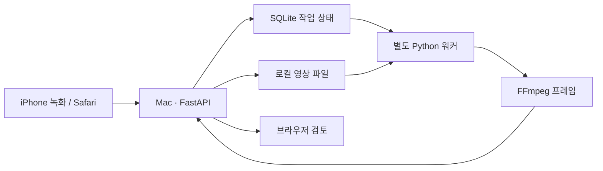

# Pokémon GO Box Scan

iPhone으로 직접 녹화한 Pokémon GO 화면을 Mac에서 분석해 개인 박스를 관리하는 프로젝트입니다. 최종적으로 **현재 보유한 개체 중 전투 종료 전까지 가장 많은 예상 피해를 낼 파티와 출전 순서**를 추천합니다.

현재 첫 버전은 **영상 업로드(또는 Mac에 미러링한 iPhone 화면의 실시간 캡처) → 로컬 저장 → SQLite 작업 등록 → FFmpeg 프레임 추출 → OCR·IV 판독과 레벨 계산 후보 → 확인·수정 후 박스 저장 → Excel 내보내기·백업 → 일반 레이드·맥스배틀 추천**까지 실행됩니다. 그림자 레이드 추천은 아래 로드맵에 있습니다.

- [현재 기준 기획서 v1.2](docs/spec-v1.2.md)에는 요구사항, 데이터 모델, API, 검증 목록과 출처를 보존합니다.
- [외부 자료 출처](docs/data-sources.md)에는 기준 데이터·보스 목록·이벤트 달력·포켓몬 이미지를 어디서 언제 받아 어디에 두는지와 이용 조건을 한곳에 모았습니다.
- [v1.1 보관본](docs/archive/spec-v1.1.md)에는 초기 조사, 수식과 엔드포인트 후보가 남아 있습니다. 범위나 계산 정책이 다르면 v1.2를 따릅니다.
- [프로젝트 검증 안내](harness/README.md)에서 테스트 명령과 확인 범위를 볼 수 있습니다.

## Mac에서 실행

Homebrew로 `uv`와 `ffmpeg`를 설치합니다. Python 3.12와 패키지 버전은 `.python-version`과 `uv.lock`으로 관리합니다.

```sh
brew install uv ffmpeg
git clone https://github.com/tlsrltjq/pokemon-go-box-scan.git
cd pokemon-go-box-scan
uv sync --locked
uv run --locked python -m boxscan doctor
uv run --locked python -m boxscan reference update
uv run --locked python -m boxscan serve
```

`reference update`는 레벨 계산용 기준 데이터를 `data/reference/`에 내려받습니다. 이 명령을 실행할 때만 인터넷에 접속하며, 분석 중에는 받은 데이터만 사용합니다. 앱을 업데이트한 뒤 정리 파일만 다시 만들 때는 내려받기 없이 `reference rebuild`를 실행합니다. 아래 [레벨 계산](#레벨-계산)을 참고하세요. 보스 목록·이벤트 달력은 `raids update`(또는 화면 버튼), 포켓몬 이미지는 화면의 `포켓몬 이미지 받기`로 받습니다. 받는 곳과 저장 위치는 [외부 자료 출처](docs/data-sources.md)에 모두 정리했습니다.

다른 터미널에서도 같은 디렉터리로 이동해 워커를 실행합니다.

```sh
uv run --locked python -m boxscan worker
```

화면은 위쪽 막대에서 스캔·내 박스·레이드·이벤트·레이드 추천·맥스배틀 추천으로 오가고, Mac의 라이트·다크 모드를 따릅니다. Mac에서 브라우저로 `http://127.0.0.1:8000`에 접속해 MOV나 MP4를 올립니다. 성공하면 갤러리에 프레임이 나타나고, 이어서 워커가 OCR·IV를 판독해 개체별 카드(종·CP·최대 HP·IV·레벨·기술과 근거 프레임)를 보여줍니다. 2 GiB 이하 영상의 처음 10분에서 1초마다 프레임을 추출하며, 최대 600장을 보여줍니다. 10분보다 긴 영상은 앞 10분만 읽고 프레임 목록 옆에 알립니다. 업로드를 마치면 브라우저를 닫아도 실행 중인 워커는 계속 처리합니다. 결과 페이지 주소로 다시 열 수 있습니다.

개인 영상 없이 확인하려면 합성 클립을 생성할 수 있습니다.

```sh
ffmpeg -f lavfi -i color=c=blue:s=360x640:r=12 -t 7 -c:v mpeg4 /tmp/boxscan-demo.mp4
```

`/tmp/boxscan-demo.mp4`를 업로드해 영상 저장, 프레임 추출, 결과 조회를 확인합니다. 실제 녹화에서는 상세 상단, 기술, 조사 화면이 선명해지면 약 1초 보여주고 넘어가세요. 1초보다 짧게 지나가는 화면은 추출 시점에 따라 빠질 수 있습니다. OCR 단계에서는 장면 변화도 활용해 프레임을 고를 예정입니다.

### OCR·IV 판독 실험

워커는 Xcode 명령줄 도구(`swiftc`)가 있으면 시작할 때 Apple Vision 도구를 `.tooling/`에 컴파일하고, 프레임 추출이 끝난 스캔마다 판독을 실행합니다. `swiftc`가 없으면 프레임 추출만 하고 화면에 건너뛴 이유를 표시합니다. 판독이 실패해도 프레임은 그대로 볼 수 있습니다.

이전에 올린 스캔을 다시 판독하려면 다음 명령을 실행합니다. 스캔 ID는 결과 페이지 주소의 `?scan=` 뒤에 있는 값입니다.

```sh
uv run --locked python -m boxscan analyze <스캔 ID>
```

검토용 1초 프레임에서 Apple Vision으로 글자를 읽고, CP·최대 HP·조사 문구의 종 이름과 기술 목록을 추출합니다. 기술은 왼쪽의 이름과 같은 줄 오른쪽의 위력(`140+28`처럼 날씨 보너스 포함)을 짝지어 찾고, 탭 제목 바로 아래 줄을 노말어택으로 봅니다. CP나 최대 HP가 연속으로 바뀌는 지점에서 개체 구간을 나누고 값을 다수결로 정합니다. IV는 원본 영상을 초당 24장으로 다시 읽어 막대 끝이 0.5초 이상 같은 값에 머문 구간에서 판정합니다. 결과는 스캔 폴더의 `analysis.json`에 후보로 저장하며, IV 판정에 사용한 프레임은 `iv-01.jpg`처럼 함께 남깁니다. 박스에는 사용자가 카드에서 확인해 저장한 값만 들어갑니다.

현재 한계는 다음과 같습니다.

- IV 막대 위치는 카카오톡으로 재압축된 iPhone 녹화(332×720) 한 개로 맞췄고, 2026-11-25에 같은 기기의 원본 해상도 녹화(1170×2532) 한 개에서도 같은 IV 3마리를 읽었습니다. 다른 기기, 다른 언어에서는 원본 프레임과 비교해 다시 확인해야 합니다.
- 기술 이름은 다수결로 정한 화면 글자를 그 종의 기술 목록과 대조합니다. 정확히 같은 이름이 우선이고, 없으면 목록 안에서 충분히 비슷한 이름으로 고친 뒤 원래 글자를 함께 보여줍니다. 종을 모르면 전체 사전과만 대조하며 `*`는 판단하지 않습니다. 별명은 OCR 원문으로만 남깁니다.
- `*` 기준: 대단한 기술머신 노말어택·스페셜어택으로만 배울 수 있는 기술(게임 데이터의 elite 목록), 그림자 포켓몬 전용 기술(화풀이)과 정화된 포켓몬 전용 기술(은혜갚기), 사전에 있지만 그 포켓몬이 지금 배울 수 있는 기술 목록에 없는 기술.
- 개체 구간은 CP·최대 HP·종 이름의 변화로만 나눕니다. 같은 종·같은 CP 개체가 연속으로 나오면 하나로 묶일 수 있습니다.
- OCR 원문에는 트레이너 이름과 잡은 장소가 포함됩니다. `analysis.json`은 로컬 `data/`에만 둡니다.

### 실시간 캡처

녹화 파일 대신 Mac에 띄운 iPhone 화면을 바로 읽을 수 있습니다. 스캔 화면의 `실시간 캡처` 탭에서 창을 고르고 `캡처 시작`을 누른 뒤, 포켓몬마다 상세 화면·기술·조사 화면을 1초 이상씩 보여 줍니다. 읽은 개체가 몇 초 간격으로 아래 판독 후보에 나타나고, `중지하고 마무리`를 누르면 남은 프레임까지 읽고 끝납니다. 이후 확인·저장은 녹화 영상과 같습니다.

캡처 중에는 지금 화면의 포켓몬에 대해 `상세 화면(CP·HP)`·`기술`·`조사 화면(IV 막대)` 체크리스트가 보이고, 아직 못 읽은 화면을 다음 할 일로 알려 줍니다. 다이맥스·거다이맥스 포켓몬은 더 아래에 있는 `맥스기술`까지 체크합니다(자시안·자마젠타처럼 모습 변화 칸이 있으면 맥스기술이 더 아래에 있어 빠뜨리기 쉬움). 모두 읽으면 테두리가 초록색으로 바뀌며 "다음 포켓몬으로 넘기세요"와 함께 짧은 소리가 납니다(`다 읽으면 소리로 알리기`로 끌 수 있고, 브라우저 정책상 `캡처 시작`을 누른 뒤부터 소리가 납니다). 화면은 사용자가 직접 넘깁니다. 앱은 게임에 아무 입력도 하지 않습니다. 기술은 노말어택과 스페셜어택 하나를 읽으면 체크하므로, 스페셜어택이 두 개인 포켓몬은 두 번째 기술까지 보이는지 직접 확인하세요. 화면을 읽고 알리기까지 1~2초 걸립니다(1초마다 저장한 이미지를 0.5초마다 읽고, 화면은 0.7초마다 새로 고침). 체크를 기다리지 않고 화면마다 1~2초씩 보여 주며 넘겨도 되고, 알림은 빠진 화면을 알려 주는 안전장치입니다.

1. iPhone 화면을 Mac에 띄웁니다. macOS의 **iPhone 미러링** 앱(iPhone이 잠긴 상태에서 Mac으로 조작) 또는 iPhone 제어 센터의 **화면 미러링**으로 Mac(AirPlay 수신)을 고릅니다. 같은 Wi-Fi가 필요합니다.
2. 처음 한 번 **화면 기록 권한**을 허용합니다. 시스템 설정 > 개인정보 보호 및 보안 > 화면 및 시스템 오디오 기록에서 서버를 실행한 앱(예: 터미널)을 켜고 그 앱과 서버를 다시 시작합니다. 권한이 없으면 화면에 이 안내가 나옵니다.
3. `창 목록 새로고침`을 누르면 iPhone 미러링·AirPlay로 보이는 창에 ★가 붙어 맨 위에 옵니다.

동작 방식: Swift 도구(`boxscan/window_capture.swift`, ScreenCaptureKit)가 고른 창 하나만 1초에 10번 읽습니다. 창의 테두리(iPhone 미러링의 회색 틀·도구 막대, AirPlay의 검은 여백, 투명한 모서리)는 잘라 내고 휴대폰 화면만 씁니다. 캡처 중 창 크기가 바뀌어도(도구 막대가 나타났다 사라지는 경우 등) 창을 프레임에 맞춰 늘린 뒤 검은 여백까지 잘라 냅니다. 작은 프레임은 IV 막대 판독에 쓰고, 1초마다 720px JPEG 한 장을 저장해 OCR에 씁니다. 업로드한 영상과 같은 판독 규칙을 쓰고, 결과는 일반 스캔과 같은 폴더·화면에 남습니다. 영상은 저장하지 않으므로 IV 근거 이미지는 막대가 멈춘 시점에 가장 가까운 1초 프레임입니다. 한 번에 하나만, 최대 10분까지 캡처합니다. 화면이 바뀌지 않은 1초는 JPEG를 저장하지 않고, IV 근거는 그 전에 저장한 마지막 1초를 씁니다. 화면을 읽기만 하며 게임 입력·네트워크 전송은 하지 않습니다. 서버가 캡처 중에 종료되면 그때까지 읽은 결과를 남깁니다. 실시간 캡처한 스캔을 `analyze`로 다시 판독하면 캡처 중 읽은 조사 화면(`live.json`)을 그대로 씁니다.

확인 범위(2026-11-22): 실제 녹화 영상을 테두리 없는 창(ffplay)으로 재생해 이 도구로 캡처했고, 뮤츠 15/12/15·그란돈 15/14/14가 영상 업로드 판독과 같게 나왔습니다. 실제 iPhone 미러링 창에서 포켓몬 GO 박스 화면이 막히지 않고 캡처되며 회색 틀이 잘리는 것을 확인했습니다. 미러링 화면에서의 상세·조사 화면 판독 정확도와 AirPlay 창은 아직 확인하지 않았습니다.

### 레벨 계산

CP 글자는 밝거나 움직이는 배경 위에서 끝자리가 빠지거나(`CP349`) 하나 더 붙어(`CP34921`) 읽히기도 합니다. 그래서 같은 개체에서 읽힌 CP 후보를 모두 모아 두고(`CP` 없이 숫자만 크게 읽힌 줄 포함), 가장 많이 읽힌 CP로 레벨이 맞지 않으면(충돌) 종·IV·최대 HP와 맞는 다른 후보를 씁니다. 바꾼 경우 판독 카드에 "가장 많이 읽힌 349 대신 HP·IV와 맞는 값"처럼 표시합니다. IV를 읽기 전에는 바꾸지 않습니다.

포켓몬 모습이 CP 숫자를 가리면(`CP167…`) 맞는 후보가 아예 없을 수 있습니다. 이때는 같은 상세 화면의 `강화` 버튼 줄에 보이는 다음 1회 강화 비용(별의모래·사탕, 레벨 40부터 사탕XL)이 레벨을 두 레벨 남짓으로 좁히므로, 최대 HP와 IV로 레벨을 하나로 정하고 그 레벨의 CP를 씁니다. 반짝반짝(별의모래 절반)·그림자(×1.2)·정화(×0.9)와 무한다이노처럼 사탕 비용이 따로 정해진 종도 게임 마스터 값으로 계산합니다. 레벨이 하나로 정해지지 않으면 일부만 읽힌 CP 숫자(`167`)와 맞는 쪽을 고르고, 그래도 여러 개면 바꾸지 않습니다. 2026-11-23 실시간 캡처 2개(115마리)를 다시 판독한 결과 강화 비용을 114마리에서 읽었고, CP가 가려진 2마리(야느와르몽 1675, 배바닐라 1600)를 사용자가 고친 값과 같게 계산했으며, 레벨이 확정된 107마리 모두 읽은 강화 비용과 맞았습니다. 새 기준 데이터 항목이라 `python -m boxscan reference rebuild`가 필요합니다.

종(조사 문구), IV, CP, 최대 HP로 레벨을 구합니다. 기준 데이터의 모든 레벨에 CP·HP 공식을 적용해 화면 값과 같은 레벨만 남깁니다.

| 결과 | 의미 |
| --- | --- |
| 하나로 정해짐 (`RESOLVED_BY_CONSTRAINTS`) | 맞는 레벨이 하나입니다. 높은 CP에서는 대부분 이렇게 정해집니다. |
| 후보 여러 개 (`AMBIGUOUS`) | 낮은 CP 등에서 이웃 레벨이 같은 값을 냅니다. 다음 강화 비용으로 좁히는 것은 후속 단계입니다. |
| 맞는 레벨 없음 (`CONFLICT`) | CP·HP·IV·종 중 하나를 잘못 읽었거나, 메가진화·베스트 파트너·다른 모습처럼 아직 반영하지 않은 상태일 수 있습니다. |

기준 데이터는 다음 다섯 파일(합계 약 20MB)입니다. 받은 시각, 원본 주소, SHA-256을 버전 폴더의 `manifest.json`에 남기고, 분석에는 정리한 `reference.json`만 읽습니다. 새로 받은 데이터가 형식·교차 검사를 통과하지 못하면 이전 버전을 유지합니다. 재배포 조건을 확인하지 않았으므로 Git에는 넣지 않습니다.

- 종족값, 레벨별 CP 배율(CPM), 기술 목록, 메가·합체 정보: [alexelgt/game_masters](https://github.com/alexelgt/game_masters) `GAME_MASTER.json`. 게임 파일에서 추출한 비공식 자료이고 저장소에는 교육용이라고만 적혀 있습니다. 이전에 쓰던 PokeMiners 게임 마스터는 2026-08-29 이후 갱신되지 않아 2026-11-15에 바꿨습니다.
- 교차 검사와 보조 종족값: [PoGo API](https://pogoapi.net/documentation/) `cp_multiplier.json`, `pokemon_stats.json`. 게임 마스터에 없는 종만 PoGo API 종족값으로 채웁니다.
- 한국어 종 이름 → 도감 번호: [PokeAPI `pokemon_species_names.csv`](https://github.com/PokeAPI/pokeapi/tree/master/data/v2/csv)
- 한국어 기술 이름: PokeAPI `move_names.csv`. 게임 마스터의 기술 ID(`PSYSTRIKE`, `MUD_SHOT_FAST` 등)를 영어 이름으로 맞춘 뒤 한국어 이름을 붙입니다. 웨더볼처럼 타입별로 나뉜 기술은 같은 이름을 씁니다. 확인 시점에 한국어 이름을 붙이지 못한 기술은 2개(`GULP_MISSILE_GORGING`, `GULP_MISSILE_GULPING`)였습니다.

게임 마스터에는 정수 레벨의 CPM만 있습니다. 반 레벨은 레벨 40 미만에서 `√((CPM(l)² + CPM(l+1)²) / 2)`, 40 이상에서 두 값의 평균으로 계산합니다. 이 규칙은 PoGo API 표와 레벨 45까지 89개 레벨에서 최대 3×10⁻⁸ 차이로 일치했습니다(2026-11-15). 45.5~49.5는 같은 규칙을 적용했으며 외부 표와 대조하지 않았습니다.

현재 한계는 다음과 같습니다.

- 레벨은 강화 가능한 최대치인 50까지 확인합니다. 베스트 파트너 보정(+1)이 적용된 CP는 `CONFLICT`로 나올 수 있습니다.
- 2026-11-15에 받은 게임 마스터는 2026-11-11 무렵 업로드된 것입니다(`timestamp.json` 기준). 이후 추가·조정된 포켓몬은 다음 `reference update`까지 반영되지 않습니다. 게임 마스터와 PoGo API 모두에 없는 종(확인 시점 1종)은 `UNKNOWN_SPECIES`로 표시합니다.
- 메가진화·원시회귀 중인 개체는 그 모습의 종족값으로 레벨을 구하고, 기본 모습 CP·최대 HP를 계산값으로 함께 냅니다.
- 같은 종에 여러 모습이 있으면 기본 모습을 우선하고, 다른 모습(알로라의 모습 등)으로도 맞으면 함께 표시합니다. 모습을 화면에서 판별하지는 않습니다. 한국어 이름이 확실한 지역 모습과 아머드 뮤츠만 한국어로 바꾸고, 나머지는 게임 데이터 이름(`Fall_2019` 등)을 그대로 보여줍니다.
- 다음 1회 강화 비용은 CP를 읽지 못했을 때만 씁니다(위 설명). 베스트 파트너 레벨은 아직 사용하지 않습니다.

### 박스에 저장

판독 후보는 한 줄에 한 마리씩, 상세·IV 화면 썸네일과 종·CP·HP·IV·기술 입력칸, 저장 방식과 `저장` 버튼이 나란히 놓입니다(좁은 화면에서는 두세 줄로 접힘). 저장하기 전에는 화면에서 읽은 값만 보여 주고, 레벨 같은 계산 값은 저장할 때 계산해 내 박스에 보여 줍니다. 아래 얇은 줄에 이로치·반짝·배경·그림자·다이맥스·별명과, 다이맥스 포켓몬이면 맥스기술 세 칸(이름과 레벨 1~3·잠김)을 두어 잘못 읽힌 맥스기술을 그 자리에서 고쳐 저장할 수 있습니다. 내 박스의 `수정`에서도 맥스기술을 고칠 수 있습니다. 아래로 스크롤한 채 다음 포켓몬으로 넘기면 다음 포켓몬의 기술이 CP보다 먼저 보이므로, 노말어택이 바뀌는 곳도 개체 경계로 봅니다(같은 종이 연달아 같은 노말어택이면 나누지 못함). 2번째 스페셜어택 해방 버튼이 `해바`처럼 읽혀도 기술로 보지 않습니다. 그 종이 배울 수 없는 스페셜어택이나 기술 사전에 없는 이름(`히푸이` 같은 잘못 읽힌 글자)은 더 자주 읽힌 올바른 스페셜어택이 있으면 빼고, 남은 의심스러운 기술은 판독 후보에서 주황색 테두리로 표시합니다. 메가진화 조건 기술(레쿠쟈의 `화룡점정`, 게임 마스터 `evolutionMoveRequirement`)은 배우지 않았어도 기술 화면에 잠긴 채 보이므로 읽은 횟수와 상관없이 항상 빼고, 판독 후보에 뺐다고 표시합니다. 실제로 배웠다면 직접 넣습니다. 이 규칙을 쓰려면 `python -m boxscan reference rebuild`로 기준 데이터를 다시 만듭니다. 같은 종이 연달아 있고 노말어택도 같으면(예: 샹델라 두 마리) 스크롤한 채 넘긴 기술 화면이 앞 개체에 붙을 수 있으니, 포켓몬을 넘기기 전에 맨 위로 올리거나 결과를 확인하세요. 자시안(검왕)·자마젠타(방패왕)·무한다이노는 게임 마스터에서 다이맥스로 분류되고 전용 맥스어택(자시안 `거수참`, 자마젠타 `거수탄`, 무한다이노 `다이맥스포`)을 가지므로 다이맥스로 저장하고 이 이름도 맥스기술로 읽습니다. 여러 장에서 맥스기술 이름이 잘려 읽히면(`다이리커버`, `다이리크`) 온전한 이름 하나로 합칩니다. `세부`를 누르면 몇 장에서 같은 값을 읽었는지와 IV 막대·기술 설명을 보여 줍니다. 확실하지 않은 값(덜 일치하거나 HP·IV로 고친 값, 읽지 못한 칸)은 주황색 테두리로 표시합니다. 입력칸에는 판독 값이 채워져 있습니다. 원본 프레임과 비교해 틀린 값을 고친 뒤 저장합니다. 반짝반짝 포켓몬은 상세 화면의 "반짝반짝 포켓몬" 글자로 미리 체크하고, 이로치와 배경은 영상에서 아직 판별하지 못하므로 직접 체크합니다. 기존 개체를 갱신할 때는 저장된 체크 값을 불러옵니다. 레벨과 기술 `*` 표시는 저장할 때 고친 값으로 다시 계산합니다.

- **새 개체로 저장**: 종마다 따로 세는 두 자리 관리 번호가 붙습니다(마기라스 `01`·`02`, 망나뇽 `01`, 100번부터는 세 자리). 같은 종 안에서는 번호를 다시 쓰지 않습니다. 개체를 지워도 그 번호는 남고, 종을 고치면 새 종의 다음 번호를 받습니다. 번호는 내 박스에서 줄을 누른 뒤 `번호 바꾸기`로 직접 바꿀 수 있습니다. 다른 개체가 쓰는 번호를 고르면 확인을 받은 뒤 두 개체의 번호를 맞바꾸고, 바꾼 내용은 두 개체의 이력에 남습니다. 게임 별명도 새 번호로 바꿔야 다음 스캔에서 맞는 개체를 고릅니다. 이전의 박스 전체 번호(`PK0001`)는 처음 열 때 종별 번호로 바뀝니다.
- **기존 개체 갱신**: 강화나 기술 변경 후 다시 찍었다면 같은 종의 기존 개체를 고릅니다. IV가 같은 개체에는 `IV 일치`가 표시되고, 기존 값과 새 값을 표로 비교합니다. 종이나 IV가 다르거나 CP가 낮아지면 경고하고 한 번 더 확인받습니다. 비운 칸은 기존 값을 지우지 않습니다.
- **별명의 관리 번호로 자동 선택**: 게임에서 포켓몬 별명을 **종 이름 + 번호**(예: 망나뇽 01번 → 별명 `망나뇽01`, 띄어 써도 됨)로 바꿔 두면, 재스캔할 때 상세 화면의 이름 줄에서 번호를 읽고 판독한 종 안에서 그 번호의 개체를 `저장 방식`에 미리 골라 둡니다. 종 이름 뒤에 숫자 2~3자리가 정확히 읽힌 경우만 쓰고(`폴리곤2`처럼 이름이 숫자로 끝나는 종은 그 뒤의 숫자만 봄), `망나뇽O1`처럼 잘못 읽힌 글자는 고쳐 추측하지 않습니다. 이전 형식(`마기PK2`)도 읽습니다. 종을 읽지 못했거나, 그 종에 없는 번호, 제거한 개체의 번호는 고르지 않고 이유를 보여 줍니다. 별명의 번호와 다른 개체를 갱신하려 하면 경고합니다. 한 영상에서 번호가 바뀌면 다른 개체로 나눕니다.
- **게임 별명**: 상세 화면 이름 줄(HP 바로 위)을 `게임 별명` 칸에 채워 함께 저장합니다. 별명이 없는 포켓몬은 종 이름이 읽힙니다. 앞에 붙는 `R` 같은 글자는 화면 아이콘이 글자로 읽힌 것일 수 있어 그대로 두니 필요하면 고치세요. 비우고 갱신하면 저장된 별명을 그대로 둡니다.
- 같은 후보를 두 번 저장해도 개체가 두 개 생기지 않습니다. 다른 화면에서 먼저 갱신한 개체를 덮어쓰려 하면 거절하고 최신 값을 다시 확인하게 합니다.

**사탕 기록**: 상세 화면의 `사탕`·`사탕XL`·`메가/원시 에너지`와 계정의 `별의모래`를 숫자 위치(라벨 바로 위)로 읽어, 판독 후보를 저장할 때 진화 계열별로 갱신합니다(마기라스 → 애버라스의 사탕; 이번에 읽지 못한 값은 이전 값 유지). 게임은 사탕XL이 0개면 숫자를 보여 주지 않으므로, 같은 포켓몬의 프레임 2장 이상에서 사탕은 읽혔는데 XL이 한 번도 보이지 않으면 XL을 0으로 기록하고 판독 후보에 `(화면에 없어 0)`이라고 표시합니다. 트레이너 레벨 31 미만이라 XL이 표시되지 않는 계정에는 맞지 않는 가정입니다. 라벨이 `그란든의 사당`처럼 잘못 읽혀도 판독한 종의 계열과 비슷하면 그 계열로 봅니다. 내 박스 표의 `사탕 / XL` 열과 `사탕과 별의모래` 칸에서 보고 직접 고칠 수 있습니다. 녹화 기반 시험 캡처 3개에서 사탕 글자가 보인 프레임 79장 중 61장의 숫자를 읽었습니다.

스캔 없이 `내 박스`의 `+ 직접 추가`로 포켓몬을 손으로 넣을 수도 있습니다(종은 필수, 레벨·`*` 표시는 저장할 때 계산, 그 종의 다음 관리 번호가 붙고 이력에 "직접 추가"로 남음). `/box`(화면 위 `내 박스`)는 한 줄에 한 마리씩 보여 주는 표입니다(종·번호, CP, IV, 레벨, 최대 HP, 기술, 상태, 별명, 갱신일). 열 이름을 누르면 그 열로 정렬하고, 줄을 누르면 바로 아래에 수정·이력·제거와 메모가 열립니다. 표 위의 상태 버튼(다이맥스·그림자·이로치·반짝반짝·IV 100%·IV 90% 이상·레벨 미확정·별명에 번호 없음, 버튼마다 개수 표시)으로 거를 수 있고, 여러 개를 켜면 모두 맞는 개체만 보입니다. 저장한 개체를 종 이름·관리 번호·게임 별명으로 찾고(예: `마기라스 02`) 최근 갱신·CP·IV·종 이름 순으로 정렬하며, 개체별 이력(새로 저장·갱신·제거와 그때의 값, 출처 영상과 프레임)을 볼 수 있습니다. `박스에서 제거`는 목록에서만 빼고 이력과 관리 번호는 남깁니다. 박스는 `data/box.sqlite3`에 저장됩니다.

박스 카드의 `수정`으로 저장한 값을 바로 고칠 수 있습니다. 화면에 보이는 칸을 그대로 덮어쓰므로 잘못 읽힌 값을 비워서 지울 수 있고, 레벨과 기술 `*`는 다시 계산합니다. 수정할 때 확인한 revision이 그사이 바뀌었으면 거절하고 최신 값을 다시 불러옵니다. 이력에는 "직접 수정"과 메모가 남고, 직접 입력한 CP는 `CP 출처: 직접 입력`으로 기록합니다.

**메가진화 표시**: 메가진화·원시회귀가 되는 종(게임 데이터 기준, 그림자 제외)은 상태 칸에 배지가 붙습니다. 아직 메가진화해 보지 않은 개체는 `메가 가능`, 해 본 개체는 `메가 Lv.2`(메가 레벨을 알 때) 또는 `메가진화해 봄`입니다. 메가진화해 본 개체는 메가 상태로 스캔했거나(메가 이름·남은 시간), 메가 레벨이 저장됐거나, `+` 기술이 기록됐으면 저절로 그렇게 보고, `수정`의 `메가진화해 본 개체` 체크로 직접 바꿀 수 있습니다(직접 정한 값이 우선). 메가 레벨은 메가 상태 스캔에서 `+` 기술 보너스로 계산되면 함께 저장되고, 아니면 `수정`에서 넣거나 올립니다. `+` 기술이 있는 메가는 상세에 `(화면에서 확인)`·`(쓸 수 있다고 가정)`·`(안 씀)`이 나오고, `수정`에서 안 쓰게 할 수 있습니다. 위쪽 필터에 `메가 가능`·`메가진화해 봄`이 있습니다.

이 기능 전에 분석한 영상에는 별명·관리 번호가 없습니다. 다시 읽으려면 `uv run --locked python -m boxscan analyze <스캔 ID>`로 다시 분석하거나 영상을 다시 올립니다.

아직 없는 것: 메가 전후 연결. 관리 번호를 넣은 실제 게임 화면으로는 아직 확인하지 않았습니다(이름 줄 위치는 기존 녹화 7개 화면으로 확인).

### 판독 정확도 측정

자동 저장(아래, 기본 꺼짐)을 켜기 전에, 지금까지 저장한 기록으로 판독이 얼마나 맞았는지와 자동 저장 규칙을 적용했다면 어땠을지를 셉니다. 박스와 스캔은 읽기만 합니다.

```sh
uv run --locked python -m boxscan accuracy                  # 저장 기록이 있는 모든 스캔
uv run --locked python -m boxscan accuracy <스캔 ID> --details # 틀린 값을 하나씩
uv run --locked python -m boxscan accuracy --json accuracy.json
```

- **정답**: 사용자가 판독 후보를 저장할 때의 값입니다. 저장 뒤 `수정`으로 고친 칸이 있으면(같은 개체의 다음 스캔 저장 전까지) 고친 값을 정답으로 씁니다. 확인하지 않고 저장한 값이 틀렸다면 정답도 틀리므로, 측정 전에 박스 값을 한 번 확인하는 것이 좋습니다.
- **비교 값**: 판독 카드 입력칸에 처음 채워지는 값(종·CP·최대 HP·마지막 조사 화면의 IV·노말어택·스페셜어택·반짝반짝·그림자·다이맥스)입니다. 메가진화 중에 찍은 개체는 화면의 메가 CP·HP와 비교합니다. 이로치·배경·별명은 판독하지 않거나 비교에서 뺍니다.
- **판정**: 항목마다 맞음 / 틀림 / 못 읽음(후보는 비었는데 박스에는 값이 있음)으로 셉니다. 스페셜어택은 둘 중 하나만 읽은 경우를 못 읽음으로 봅니다.
- **자동 저장 규칙(안)**: 다음을 모두 만족하면 자동 저장, 하나라도 걸리면 `확인 필요`로 셉니다. 종을 읽음 · 종·CP·최대 HP·IV로 레벨이 하나로 정해짐 · CP를 HP·IV·강화 비용으로 고치지 않음 · IV를 읽음 · 한 개체에 IV가 하나뿐 · 노말어택과 스페셜어택을 읽음 · 배울 수 없거나 사전에 없는 기술이 없음 · 종·CP·최대 HP를 읽은 프레임의 60% 이상이 같은 값 · 같은 스캔에 종·IV·최대 HP가 같은 다른 후보가 없음.
- **결과**: 항목별 정확도, 자동 저장됐을 개체 중 값이 틀린 개체 수(가장 중요한 숫자), 확인 필요로 빠진 개체와 이유별 개수, 저장하지 않은 후보 중 규칙을 통과하는 것(자동이었다면 잘못 들어갔을 수 있는 중복·잡음), 기존 개체 갱신에서 별명 번호가 고른 개체와 같았는지.
- 후보 번호가 바뀌어도(스캔을 `analyze`로 다시 분석한 경우) 저장할 때 기록한 프레임 번호로 같은 후보를 찾습니다. 지금 판독 규칙으로 재려면 원본 영상이 남아 있는 스캔을 먼저 `analyze`로 다시 분석합니다. 분석 결과를 지운 스캔은 셀 수 없습니다.

확인 범위: 합성 판독 결과와 합성 박스로만 시험했습니다(2026-11-27). 실제 스캔·박스로는 아직 실행하지 않았습니다.

### 자동 저장

판독 후보를 하나씩 확인하는 대신, 규칙을 통과한 후보는 저장하고 애매한 후보만 확인하는 방식입니다(규칙 `auto-save/1`, **기본 꺼짐**). 분석이 끝난 스캔의 `판독 후보` 위에 요약이 나옵니다.

- **판정**: 후보마다 `규칙 통과 · 새 개체`, `규칙 통과 · 물몬 01 갱신`, `확인 필요: 이유`가 붙습니다. 규칙은 위 `판독 정확도 측정`의 자동 저장 규칙과 같고, 박스와도 대조합니다. 별명의 관리 번호가 있으면 그 개체를 갱신합니다. 단, 번호에 맞는 개체가 없거나 제거됐거나, 종·IV가 다르거나 CP가 낮아졌으면 확인 필요입니다. 번호가 없으면 박스에 같은 종·IV 개체가 있을 때 확인 필요입니다(같은 개체의 갱신인지 다른 개체인지 모름). 한 스캔에 같은 종·IV·HP 후보가 둘이면 둘 다 확인 필요입니다.
- **저장**: `규칙을 통과한 N마리 저장`을 누르면 통과한 후보만 한꺼번에 저장합니다. `분석이 끝나면 규칙을 통과한 후보를 자동으로 저장`을 켜면(설정은 `data/settings.json`), 다음 분석부터는 워커나 실시간 캡처가 분석을 마칠 때 바로 저장합니다. 기준 데이터가 없으면 레벨을 확인할 수 없어 저장하지 않습니다.
- **확인**: `확인 필요만 보기`를 켜면 확인할 후보만 남습니다. 확인한 후보는 지금처럼 고쳐서 저장합니다.
- **되돌리기**: 저장한 뒤 바뀌지 않은 개체는 판독 후보 줄의 `저장 취소`(새 개체는 박스에서 빼고 번호는 예약)나 `갱신 되돌리기`(이전 값 복원)로 되돌릴 수 있습니다. 직접 저장한 후보도 같습니다. 되돌린 후보는 다시 저장할 수 있고, 박스 이력에 `자동 저장`·`저장 되돌리기`로 남습니다.

확인 범위: 합성 스캔·박스로 테스트와 브라우저에서만 확인했습니다(2026-11-27). 켜기 전에 Mac에서 `accuracy`로 "자동 저장됐을 개체 중 값이 틀린 개체"가 충분히 적은지 확인하세요.

### 백업과 복원

내 박스 화면의 `백업과 복원`에서 백업을 만들고 내려받거나, 백업 zip을 골라 복원합니다. Mac에서는 명령으로도 할 수 있습니다.

```sh
uv run --locked python -m boxscan backup create                 # 박스와 기준 데이터
uv run --locked python -m boxscan backup create --with-scans    # 판독 프레임·분석 결과 포함
uv run --locked python -m boxscan backup create --with-scans --with-videos
uv run --locked python -m boxscan backup inspect <백업.zip>     # 바꾸지 않고 검사
uv run --locked python -m boxscan backup restore <백업.zip>     # 검사·확인 후 복원
```

백업은 `data/backups/`에 zip 하나로 저장합니다. 박스 데이터베이스의 일관된 스냅숏, 계산에 쓴 기준 데이터 정리본, 파일별 SHA-256을 담은 `manifest.json`이 들어가며 절대 경로는 넣지 않습니다. 복원은 먼저 형식·해시·허용된 파일 이름·데이터베이스 무결성을 검사해 미리보기를 보여 주고, 확인하면 현재 박스를 `before-restore-…zip`으로 자동 백업한 뒤 바꿉니다. 백업에 든 스캔은 지금 없는 것만 추가하며 기존 스캔은 덮어쓰지 않습니다. `data/` 폴더가 Mac에만 있으므로 중요한 백업 파일은 다른 곳에도 복사해 두세요. 복원하는 동안에는 다른 화면에서 저장하지 마세요.

서버(`serve`)가 켜져 있는 동안 1시간마다 확인해, 가장 최근 백업이 하루보다 오래됐으면 `data/backups/boxscan-auto-…zip`을 자동으로 만듭니다(박스와 기준 데이터 버전만, 약 160KB). 자동 백업도 지우지 않으니 가끔 오래된 파일을 직접 정리하고, 중요한 백업은 iCloud Drive 같은 다른 곳에 복사해 두세요.

### 특별한 상태

화면 글자로 다음 상태를 판별해 판독 카드·박스·Excel에 표시합니다. 모두 자동 후보이며 저장 칸에서 고칠 수 있습니다.

| 상태 | 판별 단서 | 처리 |
| --- | --- | --- |
| 다이맥스 / 거다이맥스 | 타입 아래 "다이맥스"·"거다이맥스" 줄 | 배지와 저장 칸에 미리 선택. 맥스기술 이름과 레벨(레벨 1, 잠김)을 함께 저장 |
| 배경 ◆ | 기술 화면의 "이 포켓몬에 있는 배경은 …" 문장 | 배경 체크 상자를 미리 체크 |
| 그림자 | 상세 화면의 "정화" 버튼이나 그림자 전용 기술(화풀이) | 그림자 체크 상자를 미리 체크하고 "확인 필요" 배지 표시. 실제 그림자 개체 영상으로는 아직 확인하지 않았으므로 직접 확인. 이름 뒤에 `(그림자)` 표시 |
| 메가진화·원시회귀 중 | 조사 문구의 이름("메가독침붕", "원시그란돈", "메가리자몽X")이나 "남은 시간" | 메가 종족값으로 레벨을 구함. 화면 CP·최대 HP는 메가진화 중 기록으로 따로 남기고, 박스의 CP·최대 HP는 레벨로 계산한 기본 모습 값(CP 출처: 계산값). 레벨이 정해지지 않으면 기본 CP를 비워 두고 덮어쓰지 않음 |
| 합체·모습 변화 | 게임 데이터의 합체·모습 변화 정보 | "합체 가능" 배지와 상대(제크로무·레시라무 등) 표시. 합체·모습 변화로만 쓰는 기술에 `*`와 "제크로무와 합체해야 쓸 수 있는 기술" 같은 이유 |
| 메가진화 추가 스페셜어택 | 이름 뒤 `+`(마지막일침+)와 위력 아래 "메가진화 보너스" | 일반 기술 칸과 따로 "메가진화 추가"로 표시·저장. `140+14`의 `+14`는 메가 레벨에 따른 보너스이므로, 그 보너스를 내는 메가 레벨이 하나뿐이면 메가 레벨로 함께 저장(판독 후보에 `→ 메가 레벨 N` 표시). 게임 마스터의 `VM_MOVE_TEMP_EVOLUTION_*` 기술과 연결하고, 없으면 화면 이름 그대로 두고 "기준 데이터에 아직 없는 기술"로 표시 |

한계: 이로치는 화면 글자로 알 수 없어 직접 체크합니다. 합체한 상태의 화면 이름은 게임 문구로 확인한 블랙큐레무·화이트큐레무만 연결했고, 네크로즈마·자시안 등 다른 모습의 한국어 이름은 해당 개체 영상을 받으면 추가합니다. 메가리자몽처럼 X·Y가 있는 종은 이름에 X·Y가 보여야 구분합니다. 메가진화 추가 스페셜어택은 2026-11-15에 받은 데이터 기준 20개(메가독침붕 마지막일침+ 140, 메가뮤츠 X·Y 등)입니다. 새로 나오는 추가 기술은 `reference update` 후에 연결되며, 그 전에는 화면 이름 그대로 "기준 데이터에 아직 없는 기술"로 표시합니다.

### 레이드 추천

화면 위 `레이드 추천`에서 보스·등급·날씨를 고르면 **혼자 할 때** 박스의 개체 중 보스를 가장 빨리 쓰러뜨릴 6마리와 출전 순서를 계산합니다(엔진 `raid-sim/4`). 순위는 ① 보스를 쓰러뜨리는가 ② 쓰러뜨리는 파티끼리는 처치 시간이 짧은 순 ③ 못 쓰러뜨리면 준 피해가 큰 순입니다. 보스 기술은 들어가기 전에 모르므로 보스가 쓸 수 있는 기술 목록만 보여 주고, 가능한 조합을 모두 계산해 평균과 가장 낮은·높은 결과를 함께 보여 줍니다. 결과 맨 위에 처치 시간이 나옵니다.

| 항목 | 계산 방식 |
| --- | --- |
| 피해 | `floor(0.5 × 위력 × 공격/방어 × 자속 1.2 × 날씨 1.2 × 상성) + 1`. 기술 위력·에너지·시전 시간·피해 시점, 상성표, 날씨, 자속 배율은 게임 마스터 값 |
| 내 포켓몬 | 공격·방어 = (종족값 + IV) × 레벨 CP 배율. 체력 가득·에너지 0으로 시작, 에너지가 모이면 정한 스페셜어택 사용. 맞은 체력의 0.5배만큼 에너지 획득. 기절하면 1초 뒤 다음 개체 |
| 회피 | 기본 `자동`. 보스 노말어택은 모두 맞고 스페셜어택은 모두 피합니다. 피해도 피해의 25%는 받고(게임 전투 설정 `dodgeDamageReductionPercent` 0.75), 피하는 동안 0.5초(`dodgeDurationMs`) 공격하지 못합니다. `자동`은 피하는 경우와 다 맞는 경우를 모두 계산해, 피하면 제한 시간 안에 덜 깨는(처치하는 보스 기술 조합이 적거나, 못 깰 때 피해가 적은) 경우에만 `다 맞으면서 하기`를 추천합니다. 둘 다 깨면 피하는 쪽을 추천하고 다 맞을 때 줄어드는 시간을 함께 보여 줍니다. `스페셜어택은 피하기`·`다 맞으면서 하기`로 고정할 수도 있습니다. 이전에 받은 기준 데이터에는 두 값이 없어 위 기본값을 쓰며, `reference rebuild` 후에는 받은 게임 마스터 값을 씁니다 |
| 보스 | 공격·방어 = (종족값 + 15) × 등급 CP 배율, HP는 등급표. 기술 사이 평균 2초 휴식, 스페셜어택은 쓸 수 있을 때 약 절반 사용(번갈아 사용으로 근사), 받은 피해의 0.5배만큼 에너지 획득 |
| 스페셜어택 2개 | 각각을 주력으로 혼자 싸워 위 순위가 높은 쪽(빨리 쓰러뜨리는 쪽, 못 쓰러뜨리면 피해가 큰 쪽)을 고르고 차이를 표시 |
| 파티 탐색 | 혼자 싸웠을 때 초당 피해 상위 12마리와 기절 전까지 준 총피해 상위 12마리(겹치면 하나로, 최대 18마리)에서 가능한 파티를 모두 추정 비교하고(보스 HP까지의 피해와 거기까지 걸리는 시간), 상위 8개 파티를 실제 순서대로 전체 계산해 고름. 2026-11-22 실제 박스(214마리)와 5성 보스 6종으로 확인한 결과, 후보 40마리 전수 비교(12~19초)와 같거나 더 높은 피해를 0.1~0.2초에 냄. 후보를 줄였으면 근사 결과로 표시 |
| 재입장 | 기본은 재입장 없음(6마리가 모두 기절하면 내 피해 종료). 켜면 사용자가 정한 지연 뒤 같은 파티가 체력 가득으로 다시 들어감 |
| 날씨 | 고른 날씨에 맞는 타입의 기술은 내 기술과 보스 기술 모두 ×1.2. `모든 날씨와 비교`를 켜면 8가지 날씨의 예상 피해와 추천 파티를 표로 비교 |
| 그림자 | 박스에 그림자로 표시한 개체는 공격 ×1.2·방어 ×0.833(게임 전투 설정 값) |
| 함께하는 트레이너 | 기본 1명(혼자). 늘리면 다른 트레이너도 나와 같은 피해를 같은 때 준다고 보고 보스 HP가 그만큼 빨리 줄어들며, 결과의 피해는 내 몫 |
| 그림자 레이드 | `그림자 레이드`를 켜면 보스 HP가 정한 비율(기본 60%)만큼 남을 때 격앙해 공격 ×1.81·방어 ×3(기본값)이 됩니다. 정화 크리스탈 진정 시점(격앙 후 몇 초)을 넣지 않으면 진정하지 않는 경우로 계산하고, 같은 파티를 반대 경우(바로 진정 또는 진정 안 함)로 계산한 피해도 함께 보여 줍니다. 격앙 시점은 함께하는 트레이너 수에 따라 달라지고, 혼자서는 격앙 전에 끝날 수 있습니다 |
| 메가진화 | 기본은 `메가 안 씀`입니다. `메가진화해 본 개체만`은 한 번이라도 메가진화한 개체(아래 `메가진화 표시`)만, `메가진화되는 개체 모두`는 아직 안 해 본 개체까지 그 모습(종족값·타입·HP)으로 후보에 넣고, 파티에는 최대 1마리만 넣습니다. 한 번 메가진화한 개체는 언제든 다시 할 수 있다고 보고 메가에너지·재사용 대기·남은 시간은 따지지 않습니다. 그 개체가 싸우는 동안 자기 공격이 같은 타입 ×1.3, 다른 타입 ×1.1입니다. 원시그란돈(땅·불꽃·풀)·원시가이오가(물·전기·벌레)·메가레쿠쟈(드래곤·비행·에스퍼)는 적힌 세 타입이 ×1.3입니다. 게임 데이터에 `+` 스페셜어택(마지막일침+ 등)이 있는 메가는 메가 모습에서 그 기술을 쓸 수 있다고 보고 계산하며, 메가 상태 스캔으로 화면에서 확인하지 않았으면 `(가정)`으로 표시합니다. 어떤 방식을 고르든 결과에 나머지 방식과의 차이를 보여 줍니다: 메가 없이 계산했으면 "메가물몬(02 · 메가 Lv.2)을 넣으면 평균 12.0초 빨리 처치합니다", 더 센 메가가 아직 메가진화하지 않은 개체면 "…(아직 메가진화 안 함)을 메가진화해서 넣으면 …"처럼 나옵니다 |

등급표(`raid-ruleset/2026-11-16`): 1성 HP 600·CP 배율 0.5974, 3성 3,600·0.73, 메가 9,000·0.79, 5성 15,000·0.79는 [Bulbapedia](https://bulbapedia.bulbagarden.net/wiki/Raid_Battle_(GO)), 메가 전설·원시회귀 22,500은 [GamePress](https://gamepress.gg/pokemongo/q-a/raid-boss-cp-multiplier)에 실린 값입니다(2026-11-16 확인). 게임 마스터에는 이 값이 없습니다. 제한 시간 기본값(1·3성 180초, 그 외 300초)과 재입장 지연은 앱이 정한 시나리오 값이며 화면에서 바꿀 수 있습니다.

메가 보너스(같은 타입 1.3·다른 타입 1.1), 원시회귀 타입 목록, `+` 기술의 메가 레벨별 배율은 게임 마스터(`MEGA_EVO_SETTINGS`, `PRIMAL_EVO_SETTINGS`)에서 읽습니다. 이전에 받은 기준 데이터에는 이 값이 없으므로 `uv run --locked python -m boxscan reference rebuild`로 정리 파일을 다시 만들어야 메가진화 옵션을 쓸 수 있습니다. 혼자 싸울 때는 다른 내 포켓몬이 대기 중이라 보너스를 받지 않는다고 보고, 메가 개체 자신의 공격에도 보너스가 붙는다는 점은 커뮤니티 자료를 따랐습니다. 메가 가용성은 실시간으로 맞추기 어려워 정적으로 다룹니다(2026-11-27 사용자 결정): 메가진화해 본 개체는 언제든 다시 할 수 있다고 보고, 메가에너지·재사용 대기·남은 시간은 계산에 쓰지 않습니다.

결과에는 예상 누적 피해(평균·범위)와 보스 HP 대비 비율, 유효 전투 시간, 기절·재입장 횟수, 개체별 피해·버틴 시간·이론 DPS, 보스 기술별 결과, 제외한 개체와 이유, 계산 가정, 계산·규칙·기준 데이터 버전이 나옵니다.

한계: 보스의 실제 기술 사용 확률·친구·파티 파워·다른 트레이너는 넣지 않았고, 회피는 모든 스페셜어택을 완벽히 피한다고 보며 피할 타이밍을 기다리는 시간은 넣지 않았습니다. 2026-11-27 합성 박스로만 확인했고 실전 처치 시간과는 대조하지 않았습니다. 베스트 파트너는 박스에 정보가 없어 반영하지 않습니다. 그림자 레이드의 격앙 시점·배율은 공식 안내([도움말](https://scopelyexplore.helpshift.com/hc/en/5-pokemon-go/faq/1187-what-are-shadow-raids/?hl=en))에 수치가 없어 커뮤니티 추정값(남은 HP 60% 또는 3분의 1 감소 무렵, 공격 +81~85%·방어 +200~300%)을 기본으로 두었고 실측하지 않았습니다. 격앙 중 HP 회복은 넣지 않았습니다. `+` 기술은 게임 데이터에 있으면 모든 메가 개체가 쓸 수 있다고 가정합니다(실제로 메가 레벨에 따라 해금되는지는 화면으로 확인하지 않음, 내 박스 `수정`에서 끌 수 있음). 위력 배율은 저장한 메가 레벨(1~4)을 쓰고, 메가 레벨이 없으면 가장 낮은 레벨(배율 1.0)로 계산합니다. 메가 레벨 4의 CP 보너스는 넣지 않았습니다. 레벨이 하나로 정해지지 않았거나 IV·기술이 연결되지 않은 개체는 제외합니다. 계산 결과를 Pokébattler 등 다른 계산기와 아직 대조하지 않았습니다.

### 맥스배틀 추천

화면 위 `맥스배틀 추천`에서 보스·등급(1~5성, 거다이맥스)·날씨·함께하는 트레이너 수를 고르면, 박스에서 다이맥스·거다이맥스로 저장한 개체 중 혼자 할 때 보스를 가장 빨리 쓰러뜨릴 3마리와 출전 순서, 다이맥스했을 때 쓸 맥스 기술 계획을 계산합니다. 일반 레이드와 별도 엔진(`max-sim/2`)입니다.

| 항목 | 계산 방식 |
| --- | --- |
| 순위 | 레이드와 같은 혼자 기준. 보스 스페셜어택마다 내 3마리만으로 쓰러뜨리는지 → 쓰러뜨리면 처치 시간이 짧은 쪽, 못 쓰러뜨리면 준 피해가 큰 쪽 → 그다음 기절이 적은 쪽. 결과 맨 위에 처치 시간을 표시 |
| 보스 기술 | 들어가기 전에 모르므로 선택 칸 없이 보스가 쓸 수 있는 스페셜어택과 타입만 보여 주고, 모두 따로 계산해 같은 비중으로 평균 |
| 회피 | 기본 `자동`. 한 마리 노림 공격은 피해 2배 피해를 50% 줄여(×1) 받고, 피할 때마다 다음 행동이 0.5초(게임 전투 설정 `dodgeDurationMs`, 없으면 기본값) 늦어짐. 전체 공격은 피하지 않음. 피하면 시간 안에 덜 깎을 때만 `다 맞으면서 하기`를 추천하고, 둘 다 깨면 피하기를 유지하며 시간 차이를 표시. 화면에서 `피하기`·`다 맞기`로 고정 가능 |
| 참가 자격 | 박스의 다이맥스·거다이맥스 상태, 하나로 정해진 레벨, IV, 기술 사전과 연결된 노말어택이 있어야 함. 아니면 제외 사유 표시 |
| 일반 단계 | 필드에는 내 포켓몬 1마리. 노말어택만 쓰는 경우와 스페셜어택도 쓰는 경우를 모두 계산해 위 순위가 높은 쪽을 고름. 피해 공식은 레이드와 같음 |
| 맥스 게이지 | 공격마다 `max(1, floor(피해 × 등급 배율 ÷ (보스 HP ÷ 200)))`(배율 1~4성 1, 5성 4, 거다이맥스 15). 에너지 구슬 15초마다 +10(끌 수 있음) |
| 맥스 단계 | 게이지가 차면 필드에 있는 개체가 3초 뒤 맥스 기술 3번(각 2.5초). 다른 개체의 맥스 기술이 교체 왕복 시간 동안의 공격보다 더 깎을 때만 그 개체로 바꿔 다이맥스(필드 개체로 보스를 끝낼 수 있으면 바꾸지 않음). 그동안 보스는 공격하지 않음 |
| 맥스 기술 | 맥스어택은 노말어택 타입(게임 마스터의 타입별 맥스어택), 거다이맥스 기술은 종별 고유 기술(게임 마스터 매핑). 위력 250/300/350·350/400/450, 다이월 보호막 20/40/60(최대 3개), 다이리커버리 최대 HP의 8/12/16% 회복(필드에 나와 있는 포켓몬만, 내 개체 중에는 기술을 쓰는 1마리만. 볼에 있는 개체는 회복 안 함). 박스에 저장된 맥스기술 레벨·잠김을 쓰고, 정보가 없으면 맥스어택 레벨 1만 있다고 봄 |
| 다이맥스 계획 | 맥스어택 3번, 다이월+맥스어택 2번, 다이리커버리+맥스어택 2번 중 해금된 계획만 비교해 위 순위가 높은 쪽 |
| 보스 | 공격·방어 = (종족값 + 15) × 등급 CP 배율. 등급별 간격(1~5성 7.5초, 거다이맥스 4초)마다 스페셜어택으로 한 마리 노림 공격(×2, 피하면 ×1)과 전체 공격(×1)을 번갈아 사용 |
| 함께하는 트레이너 | 2~4명이면 노림 공격이 나에게 올 확률만큼 피해(와 회피 시간)를 나눔. 다른 트레이너의 피해·게이지·회복은 0 |
| 파티 탐색 | 혼자 싸운 결과(위 순위) 상위 10마리에서 3마리 출전 순서를 모두 계산 |

회피 감소 50%는 공식 수치가 없어 커뮤니티 관찰값(타이밍에 따라 50~70%, [Sportskeeda 안내](https://www.sportskeeda.com/pokemon/how-dodge-attacks-pokemon-go-max-battles), 2026-11-27 확인) 중 낮은 값을 썼습니다. 실전으로 재지 않았습니다.

등급표(`max-ruleset/2026-11-27`, 11-17 표에 회피 감소만 추가): 1성 HP 1,700·CP 배율 0.15, 2성 5,000·0.38, 3성 10,000·0.5, 4성 20,000·0.6은 [Bulbapedia](https://bulbapedia.bulbagarden.net/wiki/Max_Battle), 5성 17,500·0.7과 거다이맥스 100,000·0.85, 게이지 배율·보스 공격 간격은 [PokéChespin 변경 기록](https://pokechespin.net/whatsnew)과 [Matt Simplified 안내](https://mattsimplified.com/guide/max-battles/)에 실린 값입니다(2026-11-17 확인). 게임 마스터에는 이 값이 없고 보스마다 다를 수 있습니다. 제한 시간 기본값(1~4성 480초, 5성 400초, 거다이맥스 600초)은 화면에서 바꿀 수 있습니다.

한계: 격앙, 보스 기술 사용 확률, 다른 트레이너의 피해로 보스가 더 빨리 쓰러지는 효과, 에너지 구슬을 맥스 단계 중에 줍지 못하는 점은 넣지 않았습니다. 회피는 모든 노림 공격을 같은 타이밍에 피한다고 봅니다. 거다이맥스 기술의 한국어 이름은 PokeAPI에 없어서 박스에 OCR 이름이 없으면 `거다이맥스 기술 (타입)`으로 표시합니다. 다른 계산기와 아직 대조하지 않았습니다. 혼자 거다이맥스를 상대하면 대부분 맥스 단계 전에 3마리가 모두 기절하는데, 실제로도 혼자서는 어려운 전투라 그대로 표시합니다.

### 레이드·이벤트

화면 맨 위 **지금 레이드 파티**는 현재 보스마다 한 줄씩 보스 이미지, 혼자 처치 시간(또는 피해 %), 출전 순서대로 추천 파티 이미지와 `이름 관리 번호`를 보여 줘서 게임에서 파티를 짤 때 그대로 보고 고를 수 있습니다. 줄을 누르면 아래 보스 카드로 갑니다. 그 아래 **다음 레이드**는 이벤트 달력에서 곧 시작할 레이드 보스를 모아, 누르면 그 보스로 `레이드 추천`을 미리 엽니다(출처에 등급이 없어 메가는 메가, 원시는 메가 전설, 나머지는 5성으로 짐작하므로 화면에서 바꿀 수 있습니다).

화면 위 `레이드·이벤트`(예전 이름 `현재 레이드`)는 지금 열리는 레이드·맥스배틀 보스를 등급별(메가 전설·원시회귀, 5성, 메가, 3성, 1성, 그림자 5·3·1성, 맥스배틀)로 보여 주고, 보스마다 내 박스로 계산한 추천 6마리(맥스배틀은 3마리)와 예상 피해를 붙입니다. 보스 목록은 `보스 목록 갱신 (인터넷 접속)` 버튼이나 아래 명령을 실행할 때만 내려받습니다. 화면을 열기만 할 때는 저장된 목록을 씁니다.

```sh
uv run --locked python -m boxscan raids update   # 내려받고 매핑 결과 출력
uv run --locked python -m boxscan raids show     # 내려받지 않고 저장된 목록의 매핑 결과만 출력
```

| 항목 | 방식 |
| --- | --- |
| 출처 | [pokemon-go-api](https://github.com/pokemon-go-api/pokemon-go-api)의 공개 JSON 두 개: `raidboss.json`(LeekDuck 레이드 보스 페이지를 정리)과 `maxbattles.json`(Snacknap 맥스배틀 목록을 정리). GitHub Actions가 하루 약 8번(UTC 6·8·9·10·18·20·21·22시 7분) 다시 만들고, 바뀌었을 때만 배포합니다 |
| 저장 | `data/raid-bosses/<UTC 시각>-pokemon-go-api/`에 받은 원본 그대로, `manifest.json`에 URL·받은 시각·SHA-256·크기·보스 수를 둡니다. `current`가 쓰는 목록을 가리키고, 가장 최근 20개만 남깁니다. 받기나 검사에 실패하면 이전 목록을 그대로 씁니다. 맥스배틀 파일만 실패하면 레이드 목록은 바꾸고 실패를 화면에 표시합니다 |
| 보내는 정보 | 공개 파일을 GET으로 받기만 합니다. 박스·개인 정보·검색어는 보내지 않습니다 |
| 종 매핑 | 출처의 게임 데이터 ID(`DARKRAI`, `MR_MIME`)를 기준 데이터의 종으로, 한국어 이름은 기준 데이터(PokeAPI)의 이름을 씁니다 |
| 모습·메가 | 출처 모습(`TORNADUS_INCARNATE`, `BEEDRILL_MEGA`, `KYOGRE_PRIMAL`)에서 메가진화 X·Y·원시회귀를 떼고 남은 모습을 기준 데이터의 모습과 맞춥니다. 기준 데이터에 따로 없는 모습(의상 입은 피카츄·화신폼처럼 능력치가 기본 모습과 같은 경우)은 출처의 잡을 때 CP(레벨 20, IV 15)가 기본 모습으로 계산한 값과 맞을 때만 기본 모습으로 계산하고 카드에 그 사실을 적습니다. 맞는 모습이 하나도 없으면 매핑 실패입니다. 맥스배틀 목록에는 모습 정보가 없어 영어 이름의 지역 표시(Galarian 등)와 CP 범위로 고릅니다 |
| 등급 | `lvl1`·`lvl3`·`lvl5` → 1·3·5성, `mega` → 메가, `legendary_mega`·`super_mega`·`primal` → 메가 전설·원시회귀(HP 22,500), `ex`·`ultra_beast` → 5성(카드에 표시), `shadow_lvl1/3/5` → 그림자 레이드 1·3·5성. 맥스배틀 `tier_1~5` → 1~5성, `tier_6` → 거다이맥스 |
| 매핑 실패 | 모르는 등급·종·모습, 한국어 이름 없음, 기준 데이터에 없는 메가 능력치는 버리지 않고 `매핑하지 못한 레이드 보스` 칸에 이유와 출처 값으로 보여 줍니다. CP가 맞지 않지만 모습은 찾은 경우는 계산하되 경고를 붙입니다 |
| 추천 | 기존 엔진 그대로입니다. 레이드는 `raid.recommend`(혼자 기준 처치 시간 순위, 회피 `자동`, 보스 기술 모든 조합 평균), 그림자 레이드는 기본 격앙 설정(남은 HP 60%·공격 ×1.81·방어 ×3, 진정 안 함)과 바로 진정한 경우 비교, 맥스배틀은 `max_battle.recommend`입니다. 날씨·함께하는 트레이너·`메가진화`(기본 `메가 안 씀`, 레이드 추천 화면과 같은 세 가지)를 화면에서 고르며, 레이드 카드에는 메가를 넣었을 때의 차이가 함께 나옵니다. 맥스배틀 트레이너는 최대 4명으로 계산합니다. 카드의 `레이드 추천에서 자세히`는 같은 보스·설정으로 레이드 추천 화면을 열어 제외 개체·기술별 결과·가정을 보여 줍니다 |
| 계산 저장 | 보스·설정·박스 내용(모든 개체의 값과 revision)·기준 데이터·엔진·규칙 버전이 같으면 `data/raid-bosses/cache/`의 결과를 바로 보여 줍니다. 개체를 저장·수정·삭제하면 박스 내용이 바뀌어 다시 계산합니다. 가장 최근 300개만 남깁니다 |

출처 비교(2026-11-25 확인):

| 후보 | 장점 | 단점 | 판단 |
| --- | --- | --- | --- |
| pokemon-go-api `raidboss.json`·`maxbattles.json` | 게임 데이터 ID·모습 코드, 한국어 이름, 그림자·메가 전설·원시회귀 등급을 따로 표시, 맥스배틀 목록도 있음 | LeekDuck·Snacknap을 다시 정리한 2차 자료, 배포 주기 약 하루 8번 | **선택** |
| [ScrapedDuck](https://github.com/bigfoott/ScrapedDuck) `raids.json` | LeekDuck을 직접 정리, 하루 여러 번 갱신, AGPL 공개 | 영어 표시 이름(`Shadow Tornadus (Incarnate)`, `Espeon wearing a sun scarf`)과 등급 문자열(`Mega Raids`)을 해석해야 하고 메가 전설을 구분하지 않으며 맥스배틀 없음 | 대안. 같은 날 보스 18종이 pokemon-go-api와 같았음 |
| PoGo API `raid_bosses.json` | 기준 데이터와 같은 제공자 | 마지막 수정 2025-11-11로 현재 보스와 다름 | 제외 |
| LeekDuck 페이지 직접 읽기 | 1차 정리 자료 | HTML 구조에 의존 | 제외 |

한계: 출처는 커뮤니티가 정리한 2차 자료이며 게임 공식 목록이 아닙니다. 지역·시간 한정 보스, 레이드 시간대(레이드 아워 등), 이벤트 중 바뀐 목록은 출처가 갱신되기 전까지 반영되지 않습니다. 받은 지 하루가 지나면 화면에 갱신하라고 표시합니다. 2026-11-25 기준 `maxbattles.json`은 비어 있어 맥스배틀 보스는 실제 목록으로 확인하지 못했고, 그때는 맥스배틀 추천 화면에서 보스를 직접 고르면 됩니다. 의상 보스는 기본 모습과 능력치·기술이 같다고 보고 계산합니다. 추천 엔진의 한계는 위 레이드·맥스배틀 추천과 같습니다.

**이벤트 달력**: 같은 화면 위쪽에 포켓몬 GO 이벤트 일정을 보여 줍니다. `보스 목록·이벤트 갱신` 버튼(또는 `raids update`)을 누를 때 보스 목록과 함께 [ScrapedDuck](https://github.com/bigfoott/ScrapedDuck)의 `events.json`(LeekDuck 이벤트 목록을 LeekDuck 허락을 받아 정리한 자료)을 내려받아 `data/events/`에 날짜·출처·SHA-256과 함께 저장합니다. 화면을 열기만 할 때는 내려받지 않고, 실패하면 이전 달력을 유지합니다.

| 부분 | 내용 |
| --- | --- |
| 지금 진행 중 | 옆으로 넘기는 카드. 보스 이미지, 레이드 관련을 먼저, 남은 기간 막대와 끝나는 시각 |
| 다가오는 일정 | 오늘부터 14일 날짜 줄(일정 종류별 점). 날짜를 누르면 그날 시작하는 일정이 시간표로 나옴(짧은 이벤트는 시작–끝 시각, 며칠 이어지는 이벤트는 `시작`) |
| 2주 뒤 일정 | 그 뒤에 시작하는 이벤트(접어 둠) |
| 보스 카드 | 그 보스가 들어 있는 레이드 일정이 있으면 카드 제목 아래 `4일 남음 · 12/1(화) 22:00까지` |

이벤트 이름은 출처의 영어 그대로이고, 레이드 보스·스포트라이트·커뮤니티 데이의 포켓몬 이름은 게임 데이터의 영어 이름과 맞으면 한국어로 바꿉니다(`Shadow Tornadus (Incarnate)` → `그림자 토네로스`, `Mega Charizard Y` → `메가리자몽Y`). 맞지 않는 이름은 출처 표기를 그대로 둡니다. 시간은 출처 값 대부분이 현지 시각 기준(시간대 없음)이라 그대로 쓰고, `Z`로 끝나는 값(GO 배틀리그 등)은 이 기기의 현지 시각으로 바꿉니다. 항목을 누르면 LeekDuck 안내가 새 탭으로 열립니다. ScrapedDuck 이용 조건은 출처(ScrapedDuck·LeekDuck) 표시, 유료화·광고 수익 금지입니다. 개인 사용에는 문제없지만 앱을 유료로 출시하면 쓸 수 없습니다. 2026-11-27 합성 데이터로만 화면을 확인했고 실제 목록은 아직 받아 보지 않았습니다.

2026-11-25 실제 확인: `raids update`로 받은 목록(레이드 18종: 5성 크레세리아·다크라이, 메가 4종, 3성 2종, 1성 2종, 그림자 5성 토네로스와 그림자 3성·1성 7종, 맥스배틀 0종)은 모두 매핑됐고, 의상·화신폼 5종은 CP 범위 일치로 기본 모습을 썼습니다. 실제 박스(321마리, 읽기만)를 복사한 폴더로 보스마다 추천이 나왔고, 처음 계산은 보스당 0.05~0.4초에 18종 합계 3초, 메가진화를 켜면 5성·메가 보스가 0.3~0.9초에 18종 합계 8초, 저장된 결과로 다시 열 때 18종 0.02초였습니다. 같은 폴더로 서버를 띄워 브라우저에서 화면·메가 토글·갱신 버튼·자세히 링크(메가독침붕 결과가 레이드 추천 화면과 같음)를 확인했습니다. 추천 파티가 실제 전투에서 맞는지는 확인하지 않았습니다.

### 저장 공간 정리

스캔 화면 아래 `지난 스캔과 저장 공간`에서 스캔마다 날짜·크기·찾은 개체·저장한 개체 수를 보고 다시 열거나 정리합니다. 자동으로 지우지 않고, 지우기 전에 항상 확인합니다.

| 동작 | 지우는 것 | 남는 것 |
| --- | --- | --- |
| 비우기 | 원본 영상, 프레임 | 판독 결과, 개체별 대표 이미지(상세 화면 1장), IV 근거 이미지. 박스 이력의 출처도 계속 열림. 다시 판독은 못 함 |
| 삭제 | 스캔 폴더 전체와 목록 | 박스에 저장한 값과 이력. 이력의 출처 링크만 열리지 않음 |
| 예전 기준 데이터 지우기 | 지금 쓰는 버전과 바로 전 버전을 뺀 기준 데이터 | 두 버전 |

처리 중이거나 실시간 캡처 중인 스캔은 정리할 수 없습니다. 크기 예시(2026-11-22 측정): 녹화 영상 스캔은 원본 3~7MB와 프레임 1~2MB, 기준 데이터 한 버전은 약 20MB입니다. 실시간 캡처의 1초 이미지는 장당 약 130KB(1분 약 8MB)이고, 화면이 바뀌지 않은 1초는 저장하지 않습니다. 다만 게임 화면은 포켓몬과 배경이 계속 움직여서, 시험한 녹화에서는 건너뛴 1초가 없었습니다.

### 포켓몬 이미지

`내 박스`나 `레이드·이벤트`의 `포켓몬 이미지 받기`를 누르면 박스의 포켓몬(지역 모습·폼, 이로치, 메가진화할 수 있으면 메가 모습)과 저장된 보스 목록·이벤트 달력의 보스 이미지를 내려받아 `data/sprites/`에 저장합니다. 출처는 [Pokémon Showdown](https://play.pokemonshowdown.com/sprites/)의 5세대 스타일 픽셀 스프라이트(배경 투명, 장당 약 1KB)이고, `typhlosion-hisui`(히스이 블레이범), `thundurus-therian`(볼트로스 영물폼), `charizard-megax`, `groudon-primal`처럼 모습별 이미지가 있습니다. 파일 이름은 게임 데이터의 영어 종 이름과 모습으로 만듭니다. 화면은 이 저장본만 쓰므로 페이지를 열 때 다른 사이트에 접속하지 않고, 받기 전이나 출처에 없는 모습은 이름 첫 글자만 흐리게 보여 줍니다. 어떤 포켓몬 이미지를 받는지는 출처 사이트에 보입니다(박스 값은 보내지 않음).

이미지는 게임 회사의 저작물입니다. 내 컴퓨터에서 개인적으로 보는 용도로만 받으며, 저장소에 넣거나 다시 배포하지 않습니다. 공개 출시할 때는 쓸 수 없습니다. 주소 형식·파일 이름 규칙·다시 받는 방법은 [외부 자료 출처](docs/data-sources.md#포켓몬-이미지)에 있습니다.

### 모습(지역·폼) 고르기

블레이범과 히스이 블레이범, 볼트로스 화신폼과 영물폼처럼 화면 이름이 같은 모습은 포켓몬 GO에서도 타입·종족값·기술이 다릅니다. 판독한 CP·HP·IV를 모습마다 종족값으로 맞춰 보고, 한 모습만 맞으면 그 모습으로 저장합니다(타입·전투 계산·이미지가 따라감). 두 모습이 다 맞으면 기본 모습을 먼저 고르되 판독 카드의 `모습` 칸을 주황색으로 표시하고 "히스이의 모습으로도 맞음"을 붙이며, 자동 저장에서는 `확인 필요`로 돌립니다. 판독 카드와 내 박스 `수정`의 `모습` 칸에서 직접 고를 수 있고, 고른 모습의 종족값으로 레벨을 다시 계산합니다. 화신폼·영물폼·오리진폼·어나더폼·랜드폼·스카이폼·어택폼·디펜스폼·스피드폼은 한국어 이름으로 보여 줍니다.

### 빠른 검색

어느 화면에서나 `Ctrl+K`(Mac은 `⌘K`)나 `/`를 누르거나 위쪽의 `검색`을 누르면 검색 창이 뜹니다. 내 박스 포켓몬(종·별명·관리 번호), 레이드 추천을 열 보스, 화면 이동을 한 번에 찾고 `↑` `↓` `Enter`로 엽니다. 초성으로도 찾습니다(`ㅁㄱㄹㅅ` → 마기라스). `내 박스`의 검색 칸도 초성을 받습니다.

### Excel로 내보내기

내 박스 화면의 `Excel로 내보내기`를 누르거나 Mac에서 다음 명령을 실행합니다.

```sh
uv run --locked python -m boxscan export --output ~/Desktop/pokemon-box.xlsx
```

| 시트 | 내용 |
| --- | --- |
| 포켓몬 목록 | 관리 번호, 종(이로치 `*`·반짝반짝 `♣`·배경 `◆`를 이름 뒤에 붙임, 예: `마기라스*♣◆`), 도감 번호, 모습(기본 모습은 빈칸), 다이맥스·거다이맥스, CP, 최대 HP, CP 출처(계산값), 레벨·판정·후보, IV 공격·방어·HP와 %, 노말어택·스페셜어택(`*` 포함), 맥스기술, 합체·모습 변화, 메가진화 중 CP, 메가 레벨, 사탕 계열·사탕·사탕XL, 처음 저장·마지막 갱신 시각, revision, UUID |
| 사탕 | 진화 계열별 사탕·사탕XL·에너지(종류)와 기록 시각. 별의모래는 메타데이터 시트 |
| 기술 | 개체별 기술 한 줄씩. 슬롯(노말어택·스페셜어택·메가진화 추가 스페셜어택·맥스기술), 기술 이름, 기술 ID, `*` 표시와 이유(맥스기술은 레벨·잠김) |
| 메타데이터 | 내보낸 시각, 개체 수, 앱·기준 데이터 버전, `*`·빈칸의 의미, 포함하지 않은 정보 |

읽지 못했거나 확인하지 않은 값은 0이 아니라 빈칸입니다. 모든 글자 칸은 문자열로 저장해 `=`로 시작하는 값도 수식으로 실행되지 않습니다. 영상·프레임·파일 이름·촬영 시각은 넣지 않습니다. Excel은 보기용이며 박스 복원에는 쓸 수 없습니다. 전투 추천 결과 시트는 해당 기능을 만든 뒤 추가합니다.

### AI용 md 내보내기

내 박스 화면의 `AI용 md 내보내기`를 누르면 `pokemon-box-ai-날짜.md` 파일 하나를 받습니다. 이 파일을 내가 쓰는 Claude·ChatGPT 등에 올려서 "별의모래 30만으로 누구를 키울까?", "지금 레이드 중 혼자 깰 수 있는 보스는?"처럼 물어봅니다. **앱은 AI에 아무것도 보내지 않습니다.** 파일을 어디에 올릴지는 사용자가 정합니다.

| 부분 | 내용 |
| --- | --- |
| AI에게 주는 안내 | 숫자(레벨·CP·IV·피해·처치 시간)는 앱이 계산한 값이니 다시 계산하지 말고 근거로 인용할 것, `-`는 모르는 값, 개체는 `종 + 관리 번호`로 부를 것, 혼자 레이드 기준, 파일에 없는 정보(강화 비용·메타)는 구분해서 말할 것 |
| 자원 | 별의모래, 계열별 사탕·사탕XL·메가 에너지 |
| 내 박스 | 한 줄에 한 마리: 번호, 종(기호), 모습, CP, 최대 HP, 레벨(또는 후보), IV와 %, 기술, 상태(그림자·다이맥스와 맥스기술·메가 가능/메가 Lv/메가진화해 봄과 + 기술), 사탕 계열 |
| 현재 레이드·맥스배틀 추천 | 저장된 현재 보스 목록이 있으면 보스마다 추천 파티(출전 순서), 처치 시간 또는 피해, 다 맞기 추천, 메가진화 비교. 날씨 없음·혼자·메가 없이 계산하고, `현재 레이드` 화면과 같은 저장 결과를 씁니다(목록을 내려받지는 않음) |
| 계산 기준·질문 예시 | 레벨·레이드·회피·메가 가정, 커뮤니티 추정값, 실전 미검증, 물어볼 만한 질문 |

현재 레이드 추천 없이 박스만 받으려면 `/api/exports/box-ai.md?raids=false`를 엽니다. Excel처럼 영상·프레임·파일 이름·촬영 시각은 넣지 않고, 표 칸의 `|`는 이스케이프해 별명이나 이름이 표를 깨지 않게 합니다. 보스가 많으면 처음 한 번은 추천을 계산하느라 몇 초 걸립니다.

### Mac 없이 녹화해 두었다가 올리기

Mac이 꺼져 있어도 iPhone 기본 **화면 기록**으로 스캔해 두고, 나중에 Mac을 켠 뒤 위의 `녹화 영상 올리기`로 올리면 됩니다. 녹화할 때는 Mac·서버가 필요 없습니다.

1. iPhone 설정 > 제어 센터에 `화면 기록`을 추가하고, 알림 배너가 화면에 섞이지 않게 집중 모드를 켭니다.
2. 제어 센터에서 화면 기록을 시작하고 포켓몬마다 상세 상단 → 기술(아래로) → 조사 화면을 1초 이상씩 보여 줍니다. 한 영상은 10분 이내로 나눕니다. 녹화는 사진 앱에 저장됩니다.
3. 나중에 올립니다. (a) 같은 Wi-Fi에서 아래 [iPhone Safari로 연결](#iphone-safari로-연결)로 접속해 사진 보관함이나 `파일`에서 고르거나, (b) AirDrop으로 Mac에 보낸 뒤 Mac 브라우저(`http://127.0.0.1:8000`)에서 다운로드 폴더의 파일을 고릅니다.
4. 이후 판독 후보 확인·저장은 다른 영상과 같습니다. 녹화에는 트레이너 이름·장소가 들어가므로 올린 뒤 사진 앱에서 지우는 것을 권장합니다.

확인 범위(2026-11-25): iPhone 원본 녹화와 같은 형식의 **합성** 영상(HEVC MOV, 1178×2556 세로, 60fps, 3분, 259 MiB — 이전 한도 200 MiB면 거절)을 Apple M5 Mac의 서버에 HTTP로 올려, 워커가 1초 프레임 180장(332×720) 추출·Vision OCR·IV 막대 판독을 66초에 마쳤습니다. 실제 iPhone 원본 녹화 1개(2026-11-25 확인): iPhone에서 AirDrop으로 받은 2026-11-11 화면 기록 `ScreenRecording_MM-DD-YYYY HH-MM-SS_1.MP4`(확장자는 MOV가 아니라 MP4)는 HEVC 1170×2532 세로, 35.4초, 65MB(약 14.7 Mbps, 가변 프레임으로 평균 약 43fps)였습니다. 이 비율이면 10분은 약 1.1GB로 2 GiB 안에 듭니다(추정). 업로드와 워커 처리(프레임 36장·OCR·IV)는 10초에 끝났고, 마기라스·뮤츠·그란돈 3마리의 종·CP·최대 HP·IV·레벨·기술이 박스에 이미 저장된 값과 모두 같았습니다. AirDrop은 Mac 화면이 켜져 있고 잠금이 풀려 있어야 받으며, 받은 파일은 녹화한 날짜를 유지해 다운로드 폴더에서 최근 파일로 보이지 않을 수 있습니다. iPhone Safari가 사진 보관함 영상을 고를 때 변환·압축하는지, 10분 가까운 긴 녹화, 집 Wi-Fi 업로드 시간은 아직 확인하지 않았습니다. Safari에서 크기 한도에 걸리거나 화질이 떨어지면 AirDrop이나 `파일 앱에 저장` 후 고르세요. 기기 안에서 OCR해 작은 파일로 보내는 전용 iPhone 앱 설계안은 [iPhone 오프라인 스캔 설계](docs/iphone-offline-scan.md)에 있습니다(구현 전).

### iPhone Safari로 연결

Mac의 Wi-Fi 설정에서 집 네트워크 IPv4 주소를 확인합니다. 기존 서버를 종료하고 아래 예시 주소를 실제 주소로 바꿔 실행합니다. 워커는 동일한 프로젝트 디렉터리에서 그대로 사용합니다.

```sh
uv run --locked python -m boxscan serve --lan-ip 192.168.1.20
```

서버가 묻는 임시 접속 암호를 입력한 뒤, 같은 Wi-Fi의 iPhone Safari에서 `http://192.168.1.20:8000`에 접속합니다. 사용자 이름은 `boxscan`이고 암호는 방금 입력한 값입니다. Mac이 잠들거나 앱이 종료되면 접근할 수 없습니다. 이 HTTP 연결은 신뢰하는 집 네트워크의 테스트용입니다. 접속이 안 되면 Mac 방화벽과 Wi-Fi 기기 간 접속 설정을 확인합니다.

로컬 저장 위치는 기본 `data/`입니다. 서버와 워커에 같은 `--data-dir`을 명령 앞에서 지정해 별도 테스트 데이터를 쓸 수 있습니다. 강제 종료된 워커의 작업 복구는 후속 단계이며, 초기 버전에서 실행 중 작업이 멈추면 새 스캔으로 다시 시도할 수 있습니다.

## 구조

```text
boxscan/
  __main__.py      서버·워커 실행과 진단
  api.py           업로드·작업 상태·프레임 조회 API
  store.py         SQLite 작업 상태 및 스캔 파일 경로
  video.py         FFmpeg 프레임 추출
  analysis.py      실험: OCR·IV 판독 후보를 analysis.json으로 저장
  ocr.py           Apple Vision 도구 컴파일·실행 (vision_ocr.swift)
  fields.py        OCR 원문에서 CP·HP·종 후보 추출, 개체 구간 나누기
  ivbars.py        원본 영상의 조사 화면 IV 막대 판독
  live.py          미러링한 iPhone 창의 실시간 캡처·판독 (window_capture.swift)
  cleanup.py       스캔·기준 데이터 용량 확인과 사용자가 고른 정리(비우기·삭제)
  reference.py     기준 데이터 내려받기·검증·버전 관리 (data/reference/)
  level.py         종·IV·CP·최대 HP로 레벨 후보 계산 (메가·합체 모습 포함)
  species.py       화면 이름에서 종과 메가진화·합체 상태 분리, 합체 가능 정보
  moves.py         OCR 기술 이름을 종별 기술 목록과 대조하고 * 표시
  review.py        저장할 값 검증, 레벨·기술 * 재계산, 기존 개체와 다른 점 경고
  box.py           승인한 박스·이력·중복 승인 방지·저장 되돌리기 (data/box.sqlite3)
  autosave.py      자동 저장 규칙 판정·저장·설정 (data/settings.json, 기본 꺼짐)
  ai_export.py     내 AI(Claude·ChatGPT)에 올릴 박스·추천 결과 Markdown 내보내기
  export.py        박스 Excel 내보내기 (포켓몬 목록·기술·메타데이터)
  backup.py        백업 zip 만들기·검사·복원 (data/backups/)
  accuracy.py      판독 후보와 저장한 값 비교, 자동 저장 규칙 시뮬레이션 (읽기 전용)
  raid.py          일반 레이드 전투 계산과 파티·순서 추천
  max_battle.py    맥스배틀(다이맥스·거다이맥스) 계산과 3마리 순서·맥스 기술 계획 추천
  events.py        이벤트 달력 내려받기·저장·한국어 이름 연결 (data/events/)
  sprites.py       포켓몬 픽셀 이미지 내려받기·저장·대체 이미지 찾기 (data/sprites/, 개인 사용)
  raid_bosses.py   현재 레이드·맥스배틀 보스 목록 내려받기·저장·매핑과 보스별 추천 결과 저장 (data/raid-bosses/)
  web/             업로드·판독 카드·저장 화면, 내 박스 화면
docs/
  spec-v1.2.md     제품·기술 명세
  data-sources.md  외부 자료 출처: 받는 곳·때·저장 위치·이용 조건
  iphone-offline-scan.md  Mac 없이 녹화해 두는 경로 확인과 전용 iPhone 앱 설계안
  market-research.md  공개 출시 검토용 시장조사·경쟁 앱·육성 추천 검토 (결정 전)
  mobile-architecture.md  Android·iPhone 앱의 공통 코어·플랫폼 모듈 분리와 자동 스캔 검토 (결정 전)
  archive/         초기 조사와 개정 이력
harness/           검증 방법
tests/             업로드·프레임 추출 통합 테스트, 합성 IV 막대·OCR 파서 테스트
data/              로컬 영상·프레임·작업 DB (Git 제외)
```



긴 영상 분석을 웹 요청 수명과 분리합니다. API가 업로드 완료를 응답하면 워커가 작업을 가져가고, 화면은 상태를 조회합니다. SQLite로 작업을 한 번에 하나씩 가져오므로 개인용 서버에 별도 큐 서비스가 필요 없습니다. 현재 검토 화면은 한 출처에서 제공하는 HTML·CSS·JavaScript입니다. 승인·변경 비교·추천 화면이 추가될 때 기획서의 React·TypeScript 구성을 적용할 예정입니다.

Mac OCR은 Apple Vision으로 실험 중입니다. FFmpeg로 프레임을 뽑고, 글자는 OCR, 조사 화면의 IV는 픽셀 색 분석으로 나누어 읽습니다. 지금은 추가 패키지 없이 표준 라이브러리로 처리하며, 필요해지면 OpenCV 도입을 검토합니다. 한국어 기술명과 IV 정확도는 더 많은 샘플에서 확인한 뒤 확정합니다. 실제 사용은 집의 Mac과 iPhone을 대상으로 하며, 영상과 추출 데이터 처리는 로컬에서 이루어집니다.

## 용어 기준

화면·Excel·문서의 용어는 한국어 Pokémon GO 게임 화면의 표기를 따릅니다. 게임에 없는 개념만 앱 용어를 씁니다.

| 게임 용어 | 쓰는 곳과 메모 |
| --- | --- |
| 노말어택 / 스페셜어택 | 기술 슬롯. 코드·데이터에서는 fast / charged |
| 대단한 기술머신 노말어택 / 스페셜어택 | 게임 데이터의 elite 기술. `*` 이유에 사용 |
| 그림자 포켓몬 / 정화된 포켓몬 | 화풀이·은혜갚기 같은 전용 기술의 이유에 사용 |
| ○○의 모습 (알로라의 모습 등) | 폼. 코드·데이터에서는 form |
| 강화, 별의모래, 사탕, XL사탕 | 강화 비용: CP가 가려졌을 때 레벨·CP 계산 |
| 메가진화, 원시회귀, 베스트 파트너, 반짝반짝 포켓몬 | 아직 계산에 반영하지 않은 상태 |
| 날씨 보너스 / 메가진화 보너스 | 기술 위력 옆 `+숫자`. 아래 줄 문구로 구분 |
| 다이맥스 / 거다이맥스 / 맥스기술 | 맥스배틀 개체 표시와 맥스기술(레벨·잠김) |
| 합체 | 큐레무+제크로무 등. 합체로 바뀌는 기술의 `*` 이유에 사용 |
| 체육관 배틀 & 레이드배틀 | 기술 탭 제목. 노말어택 줄을 찾는 기준 |

이름 표시: 종 이름 뒤에 이로치 `*`, 반짝반짝 포켓몬 `♣`, 배경 `◆`를 이 순서로 붙이고, 그림자 포켓몬은 `(그림자)`를 붙입니다(예: `마기라스*♣◆ (그림자)`). 기술 이름 뒤의 `*`는 특별한 기술 표시로, 이름 표시와 따로 씁니다. 다이맥스·거다이맥스, 메가진화·원시회귀 중, 합체 가능은 이름 기호 대신 글자 배지로 표시합니다.

앱 용어: 판독 카드(자동으로 읽은 후보), 관리 번호(종마다 `01`부터), IV(공격·방어·HP 개체값 0~15), 레벨 판정. 조사 화면(공격·방어·HP 막대가 나오는 화면)의 게임 메뉴 이름은 확인 중입니다.

## 제품 결정과 학습 기록

| 주제 | 적용할 결정과 확인할 점 |
| --- | --- |
| 기록과 해석 | 화면에서 본 값, 기준 데이터로 계산한 값, 사용자가 승인한 값을 구분합니다. 프레임·촬영 시각·인식 버전을 근거로 남겨 수정할 수 있게 합니다. |
| 한국어 이름 | OCR 문자열은 별명일 수 있습니다. 종·폼·기술을 내부 ID로 정규화하며, 레거시 기술은 현재 습득 목록에 없더라도 실제 보유 중이면 유지합니다. |
| 기술 표시 | 레거시 기술과 커뮤니티 데이·이벤트 한정 같은 특별 기술은 판독 카드·박스·Excel에서 기술 이름 뒤에 `*`를 붙이고 이유를 함께 보여줍니다. 게임 데이터는 대단한 기술머신 전용 기술이 커뮤니티 데이·이벤트·예전 기술 중 어디서 왔는지 구분하지 않으므로 "대단한 기술머신으로만 배울 수 있는 기술"로 묶어 표시합니다. |
| IV와 HP | 체력 IV는 0~15 개체값입니다. `80/150 HP`의 80은 현재 체력, 150은 최대 체력입니다. 최대 HP는 레벨 역산과 전투 생존 시간에 사용하며 추천 기본은 완전히 회복한 상태입니다. |
| 레벨 | CP·종족값·CPM·IV로 레벨 후보를 구하고 최대 HP와 다음 **한 번**의 강화 비용으로 좁힙니다. 사탕 보유량과 지불 비용을 구분합니다. 비용이 반복되는 구간과 반짝반짝·그림자·정화·파트너 등의 상태를 고려합니다. 유일한 후보를 확정하고, 복수 후보나 충돌은 검토합니다. |
| 개체 동일성 | 강화하면 CP가, 기술을 바꾸면 기술 ID가 달라집니다. 기존 개체에서 재스캔을 시작해 변경 전후를 보여주고, 승인 시 UUID를 유지하며 새 이력을 저장합니다. 일괄 스캔의 종·IV 일치는 후보 제시에 사용합니다. |
| 선택 관리 번호 | 구분이 필요한 포켓몬은 종마다 따로 세는 번호를 붙여 `망나뇽01`처럼 게임 별명으로 설정할 수 있게 설계합니다(2026-11-22 박스 전체 번호 `PK0001`에서 종별 번호로, 같은 날 `PK` 없이 두 자리 숫자로 변경). 재스캔에서 같은 코드를 읽으면 기존 개체와 변경값을 먼저 보여줍니다. 코드가 없으면 기존 개체를 직접 선택할 수 있습니다. |
| 수동 승인 | 서로 다른 개체가 같은 종·IV일 수 있습니다. 개체별 부분 승인을 지원하며, 규칙(`auto-save/1`)을 통과하지 않은 재스캔의 자동 덮어쓰기를 금지합니다. 사용자가 켠 자동 저장은 되돌릴 수 있습니다. 누락 필드는 기존 값을 지우지 않습니다. |
| 메가 | 기본·메가 폼을 같은 개체의 별도 관측으로 관리합니다. 기본 OFF이고, 결과에 메가를 넣었을 때의 차이를 보여 줍니다. 한 번 메가진화한 개체는 언제든 다시 할 수 있다고 봅니다(메가에너지·만료는 추적하지 않음, 2026-11-27 결정). 메가 전용 추가 기술은 확인됨과 가정을 구분합니다. |
| 스페셜어택 2개 | 각각을 주력으로 쓸 때의 결과를 비교해 한 기술을 고릅니다. 상성과 함께 위력·에너지·피해 발생 시점·남은 시간을 고려합니다. |
| 전투 목표 | 순위를 **예상 누적 피해**로 결정합니다. 보스 기술, 기절, 교체, 재입장은 공격 가능한 시간을 바꿉니다. DPS는 보조 지표로 표시합니다. 친구·파티 파워·팀 메가 보너스는 제외합니다. |
| 일반·그림자 | 최대 6개체의 파티와 순서를 비교합니다. 그림자 공격자 보정과 그림자 보스의 격앙·진정은 별개입니다. 모르는 진정 시점은 명시된 시나리오로 계산합니다. |
| 맥스배틀 | 최대 3개체의 별도 엔진을 사용합니다. 참가 자격, 일반·맥스 단계, 맥스 기술과 레벨, 종료 규칙을 적용합니다. 동료가 게이지에 주는 영향과 팀 보너스는 별개의 입력입니다. |
| 기준 데이터 | PoGo API를 첫 후보로 쓰고, 원본 해시·시각·버전과 정규화 규칙을 기록합니다. PvE와 PvP 수치를 분리하고, 그림자·맥스 세부 규칙과 한국어 사전은 출처를 추가 검증합니다. |
| 결과 재현 | 추천 당시 개체 revision, 데이터·엔진 버전, 계산 입력과 가정을 남깁니다. 강화·수정 후에 이전 결과와 새 결과를 비교할 수 있습니다. |
| 내보내기 | Excel은 사용자가 파일을 받아 직접 활용합니다. 영상·프레임·개인 촬영 메타데이터는 Excel 기본 범위에서 제외합니다. 복원에는 별도의 DB·기준 데이터 백업을 사용합니다. |

현재 범위는 일반 레이드, 그림자 레이드, 다이맥스·거다이맥스 맥스배틀입니다. 별도 규칙이 필요한 추가 이벤트는 이후 확장합니다. 게임 계정 접근, 화면 조작 자동화, 외부 AI 호출, 미래 강화나 기술 변경을 가정한 육성 추천은 범위 밖입니다. 공개 GitHub에는 코드, 문서, 합성 테스트만 둡니다.

## 다음 구현과 실제 영상 검증

1. **프레임 수집 PoC**. 실제 iPhone 영상 5~10개체를 올려 상단·기술·조사 화면이 충분히 추출되는지 확인합니다. 가능하면 같은 종 두 마리, 기술 2개, 그림자, 메가 전후, 맥스 개체를 포함합니다.
2. **로컬 인식**. 사람 눈으로 적은 정답과 OCR·IV 결과를 비교합니다. 첫 실험에서는 재압축 녹화 1개(3개체)의 CP·최대 HP·종·IV가 원본 프레임을 눈으로 본 값과 일치했습니다. 원본 해상도 녹화와 IV 0·5·10·인접값 사례, 기술 사전 정규화가 남아 있습니다. 폼이나 개체 경계가 불확실하면 보류하고, 레벨 역산의 유일·복수·충돌 사례를 확인합니다.
3. **개인 박스**. 검토·부분 승인·강화 후 재스캔·이력·Excel·백업을 구현합니다. 개체별 승인, 기존 개체 갱신과 비교, 이력, 제거, Excel 내보내기, 백업·복원, 직접 수정을 구현했습니다. 별명에 넣은 관리 번호(종마다 `01`부터)를 재스캔에서 읽어 기존 개체를 자동으로 고르는 기능을 구현했고, 관리 번호를 넣은 실제 녹화로 확인하는 일이 남았습니다. 같은 종이나 CP를 이유로 서로 다른 개체가 합쳐지지 않는지 검증합니다.
4. **일반 레이드**. 시간, 피해 발생, 에너지, 기절·출전·재입장까지 계산합니다. 작은 박스는 모든 파티 조합과 비교해 추천을 확인합니다. 엔진(`raid-sim/4`)에 메가진화 1마리 포함(메가진화해 본 개체만·모두, 메가 없는 결과와 비교), 혼자 레이드 처치 시간 순위와 스페셜어택 회피까지 구현했습니다. 2026-11-25 외부 계산기 1차 대조: Pokébattler 공개 결과(5성, 레벨 40 공격자, 날씨 없음, 그림자·메가 제외)의 상위 30마리를 레벨 40·15/15/15로 넣어 1마리 단독 시뮬레이션 순위를 비교했습니다. 보스 5종(레지기가스·그란돈·뮤츠·레지아이스·레시라무)에서 순위 상관(스피어만)은 피해·생존을 함께 본 지표로 0.79~0.92, 초당 피해만으로 0.40~0.83, 상위 10마리 겹침은 7~9마리였습니다. 숨겨진 힘 노말어택과 우라오스·게노세크트 모습·랜드 모습 쉐이미는 기준 데이터에서 찾지 못해 비교에서 빠졌습니다. 파티 단위 피해량 대조, 보스 기술 사용 확률이 남았습니다.
5. **그림자와 맥스**. 그림자 보스 상태 전이와 맥스의 참가 조건·게이지·단계·기술을 각각 검증합니다. 맥스배틀 엔진(`max-sim/2`, 혼자 기준 처치 시간 순위와 노림 공격 회피)을 구현했고, 격앙·보스별 수치·외부 계산기 대조가 남았습니다. 그림자 레이드 격앙(남은 HP 60%·공격 ×1.81·방어 ×3)은 계산에 넣었으나 공개 자료끼리 수치가 다릅니다(2026-11-25 확인: 공격 +81%·방어 +200% 또는 +85%·+300%, 진정은 정화 크리스탈 8개·남은 HP 15% 설명이 섞임, 3성 그림자 보스 HP 4,000 설명도 있음). 실제 전투 기록과의 대조가 남았습니다.
6. **통합 사용**. 실제 20~30개체로 수집 시간과 수동 수정 시간을 측정하고, Safari, 재실행, 백업 복원까지 확인합니다. 녹화 없이 바로 읽는 실시간 캡처를 구현했고, 실제 iPhone 미러링·AirPlay 창으로의 확인이 남았습니다. Mac이 꺼져 있을 때 녹화해 두었다가 올리는 경로는 업로드 한도를 2 GiB·10분으로 늘려 합성 영상으로 확인했고, 실제 iPhone 원본 녹화로 크기·Safari 선택·정확도를 확인하는 일과 전용 iPhone 앱 결정([설계안](docs/iphone-offline-scan.md))이 남았습니다.

## 검증과 출처

```sh
uv run --locked python -m unittest discover -s tests -v
```

현재 테스트는 합성 MP4의 업로드·작업 처리·JPEG 조회, iPhone 원본 녹화 형식(세로 HEVC MOV)의 332×720 프레임 추출, 한도보다 긴 영상의 앞부분만 읽기와 안내, 99개가 넘는 IV 근거 이미지 조회, 잘못된 파일의 실패 상태, 집 네트워크 접속 인증을 확인합니다. 합성 막대로 IV 기준 위치 16개, 애니메이션 중간 정지, 너무 빨리 닫힌 조사 창, 인코딩한 영상 판독을 검사합니다. OCR 파서(CP·HP·종·기술 줄)는 합성 문자열로, Apple Vision 도구는 Mac에서 컴파일·실행 여부만 검사합니다. 저장 공간 정리는 스캔 크기·저장 개체 수, 비우기 후 대표 프레임·근거 이미지 유지, 삭제 후 박스 값 유지, 처리 중 스캔 보호, 기준 데이터 두 버전 유지와 API·다른 사이트 요청 거절을 검사합니다. 실시간 캡처는 가짜 캡처 도구로 막대·화면 판독과 개체 묶기, 현재 포켓몬 체크리스트(조사 화면이 열려 있어도 막대가 멈추면 체크), 프레임을 한 번씩만 읽기, 조기 중지와 동시 캡처 거절, 도구 실패 메시지, 서버 재시작 후 정리, 창 목록 정렬, 화면 기록 권한 안내, API를, macOS에서는 Swift 도구의 컴파일과 창 목록(또는 권한 거절) 응답을 검사합니다. 워커의 판독 상태 기록, 판독 실패 시 프레임 유지, 판독 결과 요약 API(OCR 원문 제외), 기존 DB 열 추가와 동시 시작도 검사합니다. 레벨 계산, 기준 데이터 검증·버전 유지, 기술 대조와 `*` 판정은 합성 종족값·CPM·기술 목록으로만 검사하며, 박스 저장은 신규·중복 승인·갱신 시 값 유지·오래된 revision 거절·제거 후 번호 미재사용·다른 사이트 요청 거절을, Excel은 시트 구성·빈칸 유지·수식 문자열 차단·촬영 정보 제외를, 관리 번호는 종별 번호 매기기·종 수정 시 새 번호와 이전 번호 보존·이전 박스의 번호 바꾸기, 별명 줄 판독·잘못 읽힌 번호 무시·번호가 바뀌면 개체 나누기·종과 번호로 조회(제거 포함)·자동 선택·종 미판독·그 종에 없는 번호·다른 개체 갱신 경고를, 백업은 손상·허용되지 않은 파일·다른 형식 거절, 복원 전 자동 백업, 기존 스캔 보존을, 직접 수정은 값 지우기·revision 충돌을, 레이드 엔진은 손으로 계산한 피해량, 보스 능력치, 피해 시점·제한 시간·보스 처치·교체·재입장과 작은 합성 박스에서 전수 탐색 대비 결과(5% 이내)와 메가진화(메가 종족값·HP·이름, 보너스 배율 손계산, `+` 기술은 메가 모습에서만·데이터에 있으면 가정·끄기, 파티에 1마리·같은 개체 중복 금지, 메가진화해 본 개체만·모두·메가 없음 비교, 전수 탐색 대비 5% 이내)와 메가진화 표시(메가 가능 종·메가진화해 봄 판정과 직접 정한 값 우선, 수정할 때 보내지 않은 값 유지, `+` 보너스로 메가 레벨 계산)를, 현재 레이드는 합성 보스 목록으로 종·지역 모습·메가·그림자·등급 매핑, 의상 모습의 CP 범위 확인, 모르는 등급·종·모습·한국어 이름 없음의 실패 표시, 맥스배틀 등급·지역 이름, 날짜·출처 붙은 저장과 실패 시 이전 목록 유지·오래된 목록 정리, 박스·설정이 바뀌면 다시 계산하는 결과 저장, 화면을 열 때 내려받지 않음과 API·화면·메뉴를 가짜 내려받기로 검사합니다. 맥스배틀 엔진은 손으로 계산한 게이지 충전·맥스 단계 시점, 맥스기술 레벨·해금·거다이맥스 고유 기술, 에너지 구슬·트레이너 수·다이월·다이리커버리 효과, 회피(노림 공격 피해 감소·생존 시간 증가·회피 시간만큼 늦어지는 처치), 처치 → 처치 시간 → 피해 → 기절 순위, 회피 `자동`이 시간이 모자랄 때 다 맞기를 고르는 경우, 전수 탐색 대비 결과(10% 이내)와 API를 검사합니다. 자동 저장은 규칙 통과·확인 필요 판정(레벨 불일치, 별명 번호로 갱신, 번호의 개체 없음, CP 하락, 박스에 같은 종·IV, 한 스캔의 중복 후보), 두 번 실행해도 한 번만 저장, 되돌리기(새 개체 제거와 번호 예약, 갱신 값 복원, 저장 뒤 바뀐 개체는 거절), 기본 꺼짐 설정과 분석 후 실행·오류가 분석을 막지 않음, 판독 카드와 같은 값, API를 검사합니다. 이벤트 달력은 날짜 없는 항목·잘못된 형식 거르기, 현지 시각과 UTC 변환, 진행 중·예정·끝남 순서, 한국어 이름(메가·그림자·원시·지역 모습), 실패 시 이전 달력 유지·오래된 버전 정리, 보스 목록과 함께 갱신·조회는 내려받지 않음을 검사합니다. 포켓몬 이미지는 출처 파일 이름 규칙, 박스·모습·이로치·메가·보스에서 받을 목록 만들기, 저장·출처에 없음 기억·실패 처리, 모습·이로치가 없을 때 대체 이미지, 이미지가 아닌 파일 거절, 받기 전 404와 받은 뒤 제공, 다른 사이트 요청 거절을 가짜 내려받기로 검사합니다. 실제 게임 데이터는 테스트에 쓰지 않습니다. 기기 환경과 실제 게임 화면에서의 인식 정확도는 별도 확인 항목입니다.

- 앱이 받아 오는 외부 자료(기준 데이터, 보스 목록, 이벤트 달력, 포켓몬 이미지)의 주소와 이용 조건은 [외부 자료 출처](docs/data-sources.md)에 있습니다.
- 영상 처리 도구와 의존성 재현 방법은 [FFmpeg 문서](https://ffmpeg.org/documentation.html)와 [uv FastAPI 가이드](https://docs.astral.sh/uv/guides/integration/fastapi/)를 참고합니다.
- 로컬 OCR의 언어·버전 지원은 Mac에서 확인합니다. [Apple Vision](https://developer.apple.com/documentation/vision/recognizing-text-in-images)
- 강화 비용·CPM 자료의 구조와 캐시 버전을 검토합니다. [PoGo API](https://pogoapi.net/documentation/) · [공식 강화 안내](https://niantic.helpshift.com/hc/en/6-pokemon-go/faq/2372-powering-up-pokemon/)
- 그림자 상태 변화와 맥스 단계·기술은 모드별로 검증합니다. [공식 그림자 레이드 안내](https://scopelyexplore.helpshift.com/hc/en/5-pokemon-go/faq/1187-what-are-shadow-raids/?hl=en) · [공식 맥스배틀 안내](https://pokemongo.com/en/max-pokemon-battle)
