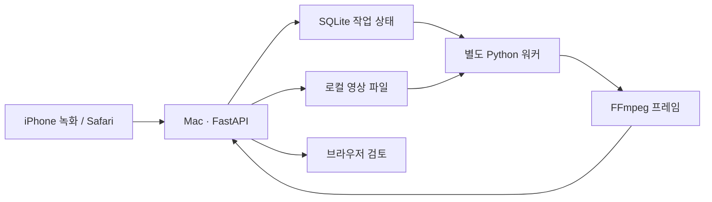

# Pokémon GO Box Scan

iPhone으로 직접 녹화한 Pokémon GO 화면을 Mac에서 분석해 개인 박스를 관리하는 프로젝트입니다. 최종적으로 **현재 보유한 개체 중 전투 종료 전까지 가장 많은 예상 피해를 낼 파티와 출전 순서**를 추천합니다.

현재 첫 버전은 **영상 업로드 → 로컬 저장 → SQLite 작업 등록 → FFmpeg 프레임 추출 → 브라우저 확인**까지 실행됩니다. OCR, 박스 확정 저장, Excel, 전투 추천은 아래 로드맵에 있습니다.

- [현재 기준 기획서 v1.2](docs/spec-v1.2.md)에는 요구사항, 데이터 모델, API, 검증 목록과 출처를 보존합니다.
- [v1.1 보관본](docs/archive/spec-v1.1.md)에는 초기 조사, 수식과 엔드포인트 후보가 남아 있습니다. 범위나 계산 정책이 다르면 v1.2를 따릅니다.
- [프로젝트 검증 안내](harness/README.md)에서 테스트 명령과 확인 범위를 볼 수 있습니다.

## Mac에서 실행

Homebrew로 `uv`와 `ffmpeg`를 설치합니다. Python 3.12와 패키지 버전은 `.python-version`과 `uv.lock`으로 관리합니다.

```sh
brew install uv ffmpeg
git clone https://github.com/tlsrltjq/pokemon-go-box-scan.git
cd pokemon-go-box-scan
uv sync --locked
uv run --locked python -m boxscan doctor
uv run --locked python -m boxscan serve
```

다른 터미널에서도 같은 디렉터리로 이동해 워커를 실행합니다.

```sh
uv run --locked python -m boxscan worker
```

Mac에서 브라우저로 `http://127.0.0.1:8000`에 접속해 MOV나 MP4를 올립니다. 성공하면 갤러리에 프레임이 나타납니다. 첫 버전은 200 MiB 이하 영상에서 앞부분 최대 72초를 3초 간격으로 읽어 최대 24장을 추출합니다. 업로드를 마치면 브라우저를 닫아도 실행 중인 워커는 계속 처리합니다. 결과 페이지 주소로 다시 열 수 있습니다.

개인 영상 없이 확인하려면 합성 클립을 생성할 수 있습니다.

```sh
ffmpeg -f lavfi -i color=c=blue:s=360x640:r=12 -t 7 -c:v mpeg4 /tmp/boxscan-demo.mp4
```

`/tmp/boxscan-demo.mp4`를 업로드해 영상 저장, 프레임 추출, 결과 조회를 확인합니다. 첫 녹화에서는 화면을 3초 이상 유지해 각 화면이 샘플에 들어오게 합니다. 실제 OCR에서는 장면 변화에 따라 프레임을 고르게 개선할 예정입니다.

### iPhone Safari로 연결

Mac의 Wi-Fi 설정에서 집 네트워크 IPv4 주소를 확인합니다. 기존 서버를 종료하고 아래 예시 주소를 실제 주소로 바꿔 실행합니다. 워커는 동일한 프로젝트 디렉터리에서 그대로 사용합니다.

```sh
uv run --locked python -m boxscan serve --lan-ip 192.168.1.20
```

서버가 묻는 임시 접속 암호를 입력한 뒤, 같은 Wi-Fi의 iPhone Safari에서 `http://192.168.1.20:8000`에 접속합니다. 사용자 이름은 `boxscan`이고 암호는 방금 입력한 값입니다. Mac이 잠들거나 앱이 종료되면 접근할 수 없습니다. 이 HTTP 연결은 신뢰하는 집 네트워크의 테스트용입니다. 접속이 안 되면 Mac 방화벽과 Wi-Fi 기기 간 접속 설정을 확인합니다.

로컬 저장 위치는 기본 `data/`입니다. 서버와 워커에 같은 `--data-dir`을 명령 앞에서 지정해 별도 테스트 데이터를 쓸 수 있습니다. 강제 종료된 워커의 작업 복구는 후속 단계이며, 초기 버전에서 실행 중 작업이 멈추면 새 스캔으로 다시 시도할 수 있습니다.

## 구조

```text
boxscan/
  __main__.py      서버·워커 실행과 진단
  api.py           업로드·작업 상태·프레임 조회 API
  store.py         SQLite 작업 상태 및 스캔 파일 경로
  video.py         FFmpeg 프레임 추출
  web/             첫 프레임 검토 화면
docs/
  spec-v1.2.md     제품·기술 명세
  archive/         초기 조사와 개정 이력
harness/           검증 방법
tests/             업로드·프레임 추출 통합 테스트
data/              로컬 영상·프레임·작업 DB (Git 제외)
```



긴 영상 분석을 웹 요청 수명과 분리합니다. API가 업로드 완료를 응답하면 워커가 작업을 가져가고, 화면은 상태를 조회합니다. SQLite로 작업을 한 번에 하나씩 가져오므로 개인용 서버에 별도 큐 서비스가 필요 없습니다. 현재 검토 화면은 한 출처에서 제공하는 HTML·CSS·JavaScript입니다. 승인·변경 비교·추천 화면이 추가될 때 기획서의 React·TypeScript 구성을 적용할 예정입니다.

Mac OCR 후보는 Apple Vision입니다. FFmpeg로 프레임을 뽑고, 글자는 OCR, 조사 화면의 IV는 OpenCV 이미지 분석으로 나누어 실험합니다. 한국어 기술명과 IV 정확도는 샘플에서 확인한 뒤 확정합니다. 실제 사용은 집의 Mac과 iPhone을 대상으로 하며, 영상과 추출 데이터 처리는 로컬에서 이루어집니다.

## 제품 결정과 학습 기록

| 주제 | 적용할 결정과 확인할 점 |
| --- | --- |
| 기록과 해석 | 화면에서 본 값, 기준 데이터로 계산한 값, 사용자가 승인한 값을 구분합니다. 프레임·촬영 시각·인식 버전을 근거로 남겨 수정할 수 있게 합니다. |
| 한국어 이름 | OCR 문자열은 별명일 수 있습니다. 종·폼·기술을 내부 ID로 정규화하며, 레거시 기술은 현재 습득 목록에 없더라도 실제 보유 중이면 유지합니다. |
| IV와 HP | 체력 IV는 0~15 개체값입니다. `80/150 HP`의 80은 현재 체력, 150은 최대 체력입니다. 최대 HP는 레벨 역산과 전투 생존 시간에 사용하며 추천 기본은 완전히 회복한 상태입니다. |
| 레벨 | CP·종족값·CPM·IV로 레벨 후보를 구하고 최대 HP와 다음 **한 번**의 강화 비용으로 좁힙니다. 사탕 보유량과 지불 비용을 구분합니다. 비용이 반복되는 구간과 반짝반짝·그림자·정화·파트너 등의 상태를 고려합니다. 유일한 후보를 확정하고, 복수 후보나 충돌은 검토합니다. |
| 개체 동일성 | 강화하면 CP가, 기술을 바꾸면 기술 ID가 달라집니다. 기존 개체에서 재스캔을 시작해 변경 전후를 보여주고, 승인 시 UUID를 유지하며 새 이력을 저장합니다. 일괄 스캔의 종·IV 일치는 후보 제시에 사용합니다. |
| 수동 승인 | 서로 다른 개체가 같은 종·IV일 수 있습니다. 개체별 부분 승인을 지원하며 재스캔 자동 덮어쓰기를 금지합니다. 누락 필드는 기존 값을 지우지 않습니다. |
| 메가 | 기본·메가 폼을 같은 개체의 별도 관측으로 관리합니다. 기본 OFF, ON은 현재 활성 또는 현재 사용 가능이 확인된 폼을 추가합니다. 만료와 사용 가능 상태, 메가 전용 추가 기술을 구분합니다. |
| 스페셜 기술 2개 | 각각을 주력으로 쓸 때의 결과를 비교해 한 기술을 고릅니다. 상성과 함께 위력·에너지·피해 발생 시점·남은 시간을 고려합니다. |
| 전투 목표 | 순위를 **예상 누적 피해**로 결정합니다. 보스 기술, 기절, 교체, 재입장은 공격 가능한 시간을 바꿉니다. DPS는 보조 지표로 표시합니다. 친구·파티 파워·팀 메가 보너스는 제외합니다. |
| 일반·그림자 | 최대 6개체의 파티와 순서를 비교합니다. 그림자 공격자 보정과 그림자 보스의 격앙·진정은 별개입니다. 모르는 진정 시점은 명시된 시나리오로 계산합니다. |
| 맥스배틀 | 최대 3개체의 별도 엔진을 사용합니다. 참가 자격, 일반·맥스 단계, 맥스 기술과 레벨, 종료 규칙을 적용합니다. 동료가 게이지에 주는 영향과 팀 보너스는 별개의 입력입니다. |
| 기준 데이터 | PoGo API를 첫 후보로 쓰고, 원본 해시·시각·버전과 정규화 규칙을 기록합니다. PvE와 PvP 수치를 분리하고, 그림자·맥스 세부 규칙과 한국어 사전은 출처를 추가 검증합니다. |
| 결과 재현 | 추천 당시 개체 revision, 데이터·엔진 버전, 계산 입력과 가정을 남깁니다. 강화·수정 후에 이전 결과와 새 결과를 비교할 수 있습니다. |
| 내보내기 | Excel은 사용자가 파일을 받아 직접 활용합니다. 영상·프레임·개인 촬영 메타데이터는 Excel 기본 범위에서 제외합니다. 복원에는 별도의 DB·기준 데이터 백업을 사용합니다. |

현재 범위는 일반 레이드, 그림자 레이드, 다이맥스·거다이맥스 맥스배틀입니다. 별도 규칙이 필요한 추가 이벤트는 이후 확장합니다. 게임 계정 접근, 화면 조작 자동화, 외부 AI 호출, 미래 강화나 기술 변경을 가정한 육성 추천은 범위 밖입니다. 공개 GitHub에는 코드, 문서, 합성 테스트만 둡니다.

## 다음 구현과 실제 영상 검증

1. **프레임 수집 PoC**. 실제 iPhone 영상 5~10개체를 올려 상단·기술·조사 화면이 충분히 추출되는지 확인합니다. 가능하면 같은 종 두 마리, 기술 2개, 그림자, 메가 전후, 맥스 개체를 포함합니다.
2. **로컬 인식**. 사람 눈으로 적은 정답과 OCR·IV 결과를 비교합니다. 폼이나 개체 경계가 불확실하면 보류하고, 레벨 역산의 유일·복수·충돌 사례를 확인합니다.
3. **개인 박스**. 검토·부분 승인·강화 후 재스캔·이력·Excel·백업을 구현합니다. 같은 종이나 CP를 이유로 서로 다른 개체가 합쳐지지 않는지 검증합니다.
4. **일반 레이드**. 시간, 피해 발생, 에너지, 기절·출전·재입장까지 계산합니다. 작은 박스는 모든 파티 조합과 비교해 추천을 확인합니다.
5. **그림자와 맥스**. 그림자 보스 상태 전이와 맥스의 참가 조건·게이지·단계·기술을 각각 검증합니다.
6. **통합 사용**. 실제 20~30개체로 수집 시간과 수동 수정 시간을 측정하고, Safari, 재실행, 백업 복원까지 확인합니다.

## 검증과 출처

```sh
uv run --locked python -m unittest discover -s tests -v
```

현재 테스트는 합성 MP4의 업로드·작업 처리·JPEG 조회, 잘못된 파일의 실패 상태, 집 네트워크 접속 인증을 확인합니다. 기기 환경과 실제 게임 화면에서의 인식 정확도는 별도 확인 항목입니다.

- 영상 처리 도구와 의존성 재현 방법은 [FFmpeg 문서](https://ffmpeg.org/documentation.html)와 [uv FastAPI 가이드](https://docs.astral.sh/uv/guides/integration/fastapi/)를 참고합니다.
- 로컬 OCR의 언어·버전 지원은 Mac에서 확인합니다. [Apple Vision](https://developer.apple.com/documentation/vision/recognizing-text-in-images)
- 강화 비용·CPM 자료의 구조와 캐시 버전을 검토합니다. [PoGo API](https://pogoapi.net/documentation/) · [공식 강화 안내](https://niantic.helpshift.com/hc/en/6-pokemon-go/faq/2372-powering-up-pokemon/)
- 그림자 상태 변화와 맥스 단계·기술은 모드별로 검증합니다. [공식 그림자 레이드 안내](https://scopelyexplore.helpshift.com/hc/en/5-pokemon-go/faq/1187-what-are-shadow-raids/?hl=en) · [공식 맥스배틀 안내](https://pokemongo.com/en/max-pokemon-battle)
