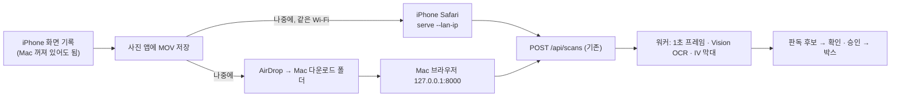
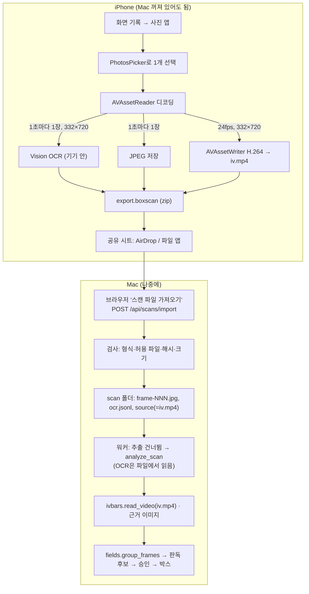

# Mac 없이 iPhone에서 스캔해 두기 — 경로 확인과 전용 앱 설계안

- 문서 ID: `pokemon-go-box-scan-offline-iphone`
- 작성·확인일: 2026-11-25 (Asia/Seoul)
- 상태: 1단계(앱 없는 경로) 구현·합성 검증 완료 / 2단계(전용 iPhone 앱) **설계안만, 구현 전·사용자 동의 대기**
- 관련: [README](../README.md)의 "Mac 없이 녹화해 두었다가 올리기", [기획서 v1.2](spec-v1.2.md) 3·4장

## 1. 질문과 결론

질문: 노트북(Mac)이 꺼져 있을 때 iPhone에서 박스를 스캔해 저장해 두고, 나중에 Mac 앱으로 불러와 박스 갱신·강화 추천에 쓸 수 있는가.

결론:

1. **새 앱 없이 지금 됩니다.** iPhone 기본 **화면 기록**으로 녹화하면 사진 앱에 저장되고, Mac을 켠 뒤 기존 `녹화 영상 올리기`로 올리면 같은 판독·묶기·승인 흐름을 탑니다. 녹화할 때 Mac은 필요 없습니다.
2. 막히는 점은 **업로드 한도**였습니다. 이전에는 200 MiB·처음 72초만 받아서, iPhone 원본 녹화(세로 고해상도 HEVC)는 몇 분이면 거절되거나 72초 뒤가 소리 없이 잘렸습니다. 이번에 2 GiB·10분(실시간 캡처와 같은 길이)으로 늘리고, 10분이 넘으면 앞 10분만 읽었다고 알리도록 고쳤습니다(아래 2장).
3. 전용 iPhone 앱(2단계)은 **선택 사항**입니다. 얻는 것은 (a) Mac으로 옮기는 파일이 수백 MB → 수십 MB로 줄고, (b) Mac을 켜기 전에 iPhone에서 "글자를 읽은 프레임 수" 정도를 미리 볼 수 있다는 점입니다. 판독 규칙은 Mac에 그대로 두므로 iPhone에서 "빠진 화면"을 정확히 알려 주려면 규칙 일부를 내보내는 추가 설계가 필요합니다(5.4). 서명·유지 비용(6장)과 비교해 결정할 일입니다.

## 2. 1단계: 앱 없는 경로의 확인 결과

### 2.1 흐름



### 2.2 이번에 바꾼 것

| 항목 | 이전 | 이후 | 이유 |
| --- | --- | --- | --- |
| 업로드 크기 | 200 MiB | 2 GiB (서버·브라우저 모두 검사, 브라우저는 보내기 전에 거절) | 합성 iPhone 형식 3분 영상이 259 MiB |
| 읽는 길이 | 처음 72초(최대 72장) | 처음 10분(최대 600장) | 실시간 캡처 한도와 같게. 한 번에 여러 마리를 녹화 |
| 10분 초과 | 소리 없이 잘림 | 프레임 목록 옆에 "처음 10분만 읽었습니다. 나머지는 나눠서" 표시 | 사용자가 빠진 개체를 모를 수 있음 |
| 프레임 추출 제한 시간 | 120초 | 600초 | 고해상도 HEVC 10분 디코딩 여유 |
| IV 근거 이미지 번호 | 두 자리(`iv-01`~`iv-99`)만 열림 | 세 자리까지 열리고 백업에도 포함 | 10분이면 조사 화면이 99개를 넘을 수 있음. 10분 실시간 캡처에도 있던 문제 |

`fields.py`·`analysis.py`·`ivbars.py`의 판독 규칙은 바꾸지 않았습니다.

### 2.3 확인한 것 (2026-11-25, Apple M5 Mac, 합성 영상)

- 합성 영상: FFmpeg `testsrc2`, HEVC(`hvc1`) MOV, 1178×2556 세로, 60fps, 3분, 12 Mbps로 인코딩 → 259 MiB. 게임 화면이 아니라 시험 패턴입니다.
- 실제 서버(`serve`, 임시 데이터 폴더)에 HTTP로 업로드 → 202 응답(이전 한도라면 413). `worker --once`가 프레임 추출·Apple Vision OCR(180장)·IV 막대 판독까지 **66초**에 마쳤습니다. 따로 재면 프레임 추출 19초, IV 판독(24fps 디코딩·막대 검사) 42초입니다. 10분이면 대략 3~4분으로 추정합니다(미측정).
- 1초 프레임은 332×720 JPEG로 나옵니다. 지금까지 판독 규칙을 맞춘 카카오톡 재압축 녹화(332×720)와 같은 크기·비율이고, IV 판독도 332px 폭으로 줄여 읽습니다.
- 자동 테스트(합성): libx265로 만든 1170×2532 HEVC `IMG_0001.MOV` 업로드 → 332×720 프레임 3장, 5초 영상에 한도 3초를 걸면 3장과 안내 문구(딱 3초 영상은 안내 없음), `iv-100.jpg` 근거 링크·백업 허용.

### 2.4 확인하지 않은 것

- **실제 iPhone 화면 기록**의 비트레이트·파일 크기. 그래서 실제 10분 녹화가 2 GiB 안에 드는지는 모릅니다. 처음 실제 녹화를 올릴 때 `ls -lh`나 Finder로 크기와 길이를 적어 두세요.
- iPhone Safari에서 사진 보관함의 영상을 고를 때 iOS가 더 호환되는 형식으로 변환·압축하는지, 그때 해상도가 줄어드는지. 줄어들어도 판독 프레임은 어차피 332×720이라 큰 문제는 아닐 것으로 추정하지만 확인 전입니다. 걸리면 AirDrop이나 `파일 앱에 저장` 후 `파일`에서 고르세요.
- AirDrop 전송 시간과 원본 유지 여부, 집 Wi-Fi에서 수백 MB 업로드에 걸리는 시간.
- 원본 해상도 실제 녹화에서의 OCR·IV 정확도. 화질은 재압축본보다 좋으므로 나빠지지는 않을 것으로 추정하지만 원본 프레임과 비교해 기록해야 합니다.
- 화면 기록 중 뜨는 알림 배너가 OCR에 섞이는 정도(집중 모드를 권장).

## 3. 2단계: 전용 iPhone 앱 — 목표와 범위

| 한다 | 하지 않는다 |
| --- | --- |
| 사용자가 고른 사진 앱의 화면 기록 1개를 읽는다 (PhotosPicker, 보관함 전체 권한 불필요) | 게임 화면 조작·입력, 게임 계정 접근, 게임 서버 조회 |
| 기기 안의 Apple Vision으로 1초 프레임 OCR | 외부 AI·클라우드 OCR 호출, 앱의 네트워크 통신 |
| OCR 원문·프레임 메타데이터·작은 프레임·IV용 축소 영상을 파일 하나로 내보내기 | CP·HP·종·기술·IV 판정, 개체 묶기, 레벨 계산 (Mac 규칙 하나로 유지) |
| 공유 시트(AirDrop·파일 앱)로 사용자가 직접 보냄 | 자동 업로드·자동 동기화, 앱스토어 배포 |

판독 규칙(`boxscan/fields.py`, `boxscan/analysis.py`, `boxscan/ivbars.py`)은 Mac에만 둡니다. 앱은 Mac의 `vision_ocr.swift`와 **같은 OCR 설정**(`.accurate`, `ko-KR`·`en-US`, 언어 보정 끔)으로 **같은 크기의 프레임**(긴 변 720px로 줄인 332×720)을 읽어, Mac이 받은 결과를 지금의 OCR 출력과 똑같이 다룰 수 있게 합니다. `fields.py`의 위치 규칙은 프레임 폭 비율과 일부 픽셀 크기를 쓰므로, 원본 해상도로 OCR하면 같은 규칙이 다르게 동작할 수 있어 크기를 맞춥니다.

## 4. 구성도



## 5. 내보내기 파일 형식 `boxscan-offline/1`

### 5.1 묶음

확장자 `.boxscan`, 내용은 압축하지 않은(stored) zip입니다. JPEG·MP4는 이미 압축돼 있습니다.

```text
manifest.json
ocr.jsonl
frames/frame-001.jpg … frames/frame-600.jpg   (332×720, 1초에 1장, 최대 600장)
iv.mp4                                        (332×720, 24fps, H.264, 소리 없음)
```

크기 추정(미측정): JPEG 장당 30~60KB(10분 18~36MB) + IV 영상 1~2 Mbps(10분 75~150MB). 원본 녹화보다 훨씬 작지만 IV 영상이 대부분입니다. 줄이려면 IV 영상을 조사 화면 근처 구간만 남기는 방법이 있는데, 그 구간을 정하는 것 자체가 판독 규칙이라 1차에서는 하지 않습니다.

### 5.2 `manifest.json`

```json
{
  "format": "boxscan-offline/1",
  "app": {"version": "0.1.0", "build": "1"},
  "recognizer": {
    "ocr": "apple-vision-accurate-ko-en/ios",
    "os": "iOS 26.1",
    "languages": ["ko-KR", "en-US"],
    "level": "accurate",
    "language_correction": false
  },
  "source": {"duration_seconds": 182.4, "width": 1179, "height": 2556, "codec": "hevc"},
  "recorded_at": "2026-11-25T21:03:00+09:00",
  "sample_seconds": 1,
  "frame_size": [332, 720],
  "frames": 182,
  "truncated": false,
  "iv_video": {"file": "iv.mp4", "fps": 24, "width": 332, "height": 720, "codec": "h264"},
  "sha256": {"ocr.jsonl": "…", "iv.mp4": "…", "frames/frame-001.jpg": "…"}
}
```

- 사진 보관함의 자산 ID, 위치, 기기 이름, 원본 파일 이름은 넣지 않습니다. `recorded_at`은 기획서 6.2의 "업로드 시각과 촬영 시각 분리"용이며 비워도 됩니다.
- 10분을 넘는 녹화는 앞 10분만 처리하고 `truncated: true`로 표시합니다(Mac 업로드와 같은 규칙).

### 5.3 `ocr.jsonl`

프레임마다 한 줄. Mac `vision_ocr.swift` 출력에서 `path`만 `frame`·`seconds`로 바꾼 형태입니다.

```json
{"frame": 1, "seconds": 0.0, "width": 332, "height": 720, "lines": [{"text": "CP2741", "confidence": 0.98, "box": [120, 88, 96, 30]}], "error": null}
```

`box`는 왼쪽 위 원점의 픽셀 `[x, y, w, h]`, 줄은 위에서 아래 순서입니다. OCR 원문에는 트레이너 이름·잡은 장소가 들어가므로 이 파일은 개인 데이터로 다룹니다(Git·공유 금지, 지금의 `analysis.json`과 같음).

### 5.4 iPhone에서 보여 줄 것 (선택)

1차 앱은 처리 결과로 "프레임 N장 중 글자를 읽은 프레임 M장, 처리 시간"만 보여 줍니다. 실시간 캡처의 체크리스트(상세·기술·조사·맥스기술)를 iPhone에도 보여 주려면 화면 구분 규칙이 필요합니다. 규칙을 Swift로 옮기면 규칙이 두 벌이 되므로, 하려면 Mac이 `fields.py`의 구분용 표식(탭 제목 문구 등)을 버전 붙은 JSON으로 내보내고 앱이 그것만 읽는 방식으로 따로 설계합니다. 결정 전입니다.

## 6. Mac 가져오기

### 6.1 API

```text
POST /api/scans/import?filename=<이름>.boxscan
Content-Type: application/octet-stream
→ 202 {"id": "<scan uuid>", "status": "queued", "frames": 182, "truncated": false}
```

- 지금의 `/api/scans` 업로드와 같은 접근 통제(Origin 검사, LAN 모드 암호)를 씁니다. 크기 한도 300 MiB.
- 거절(422): zip이 아님, `format` 미지원, 허용 목록 밖 파일 이름·폴더·링크·절대 경로·`..`, 해시 불일치, 프레임 번호가 1부터 연속이 아니거나 600 초과, JPEG 시작 바이트 아님, `ocr.jsonl`의 프레임이 묶음에 없음, `width`/`height`가 `frame_size`와 다름, 상자 좌표가 프레임 밖.
- 통과하면 스캔 폴더에 `frame-NNN.jpg`, `ocr.jsonl`, `source`(= `iv.mp4`), `import.json`(= manifest)을 쓰고 `queued`로 등록합니다. 압축 해제는 임시 폴더에서 하고 다 검사한 뒤 옮깁니다.
- 화면: 스캔 화면 `녹화 영상 올리기` 옆에 `iPhone 스캔 파일 가져오기`(`.boxscan`)를 둡니다. 이후 판독 후보·승인 화면은 같습니다.

### 6.2 워커·분석의 변경 범위

| 파일 | 변경 |
| --- | --- |
| `video.py` `run_next` | 폴더에 `import.json`이 있으면 FFmpeg 프레임 추출을 건너뛰고 바로 `ready` → 분석 |
| `analysis.py` `analyze_scan` | `ocr.jsonl`이 있으면 `ocr.recognize` 대신 파일을 읽어 같은 `{width, height, lines}`로 넘김. 결과의 `recognizer.ocr`에 앱 판독기 이름 기록. IV는 `source`(iv.mp4)를 지금처럼 `ivbars.read_video`로 읽고 근거 이미지도 지금처럼 뽑음 |
| `analysis.py` `make_analyzer` | 가져온 스캔은 `swiftc` 없이도 분석 가능 |
| `backup.py` | `ocr.jsonl`, `import.json`을 허용 파일에 추가 |
| `cleanup.py` | `비우기`는 지금처럼 `source`와 프레임을 지움. `ocr.jsonl`은 분석 결과와 같은 취급 |

`fields.py`·`ivbars.py`·`moves.py`·`level.py`는 바꾸지 않습니다. 같은 녹화를 원본 업로드와 `.boxscan` 가져오기로 각각 처리해 판독 후보가 같은지 비교하는 것이 이 설계의 핵심 검증입니다.

## 7. 서명과 설치

| 방법 | 비용 | 설치 유지 | 비고 |
| --- | --- | --- | --- |
| 무료 Apple 계정(Xcode Personal Team) | 0원 | **7일 뒤 만료**, Mac의 Xcode에서 다시 빌드·설치 | 기기당 앱 3개, 7일에 App ID 10개. iPhone에서 개발자 모드를 켜야 함 |
| Apple Developer Program | 연 99달러 | 프로필 1년 | TestFlight·Ad Hoc 가능. 앱스토어 출시는 범위 밖 |

7일마다 재설치하려면 어차피 Mac을 켜야 하므로, "Mac 없이"라는 목적과 어긋나는 때가 생깁니다. 다만 녹화는 앱 없이도 되므로, 앱이 만료돼 있으면 원본 업로드(1단계)로 돌아가면 됩니다. 출처: Apple [멤버십 비교](https://developer.apple.com/support/compare-memberships/kr/)(무료 프로필 7일·앱 3개·App ID 10개). Apple은 무료 프로비저닝 한도의 공식 문서가 없다고 포럼에서 밝혀 왔으므로 설치할 때 다시 확인합니다.

## 8. ReplayKit 방송 확장으로 실시간 캡처하는 방식 (채택하지 않음)

녹화 파일 없이 화면을 바로 읽는 방법은 ReplayKit **Broadcast Upload Extension**입니다. 제어 센터의 화면 기록에서 이 앱을 고르면 게임을 하는 동안 확장 프로세스가 화면 프레임을 받습니다.

- **메모리 50MB 한도**: 확장 프로세스가 약 50MB를 넘으면 시스템이 종료합니다. Apple 공식 수치는 찾지 못했고 개발자 포럼·SDK 문서에서 널리 보고된 값입니다([Apple 포럼](https://developer.apple.com/forums/thread/651367), [Twilio ReplayKit 예제](https://github.com/twilio/video-quickstart-ios/blob/master/ReplayKitExample)). 1179×2556 BGRA 프레임 하나가 약 12MB이고 Vision `.accurate` 모델도 메모리를 쓰므로, 확장 안에서 OCR은 위험합니다.
- 현실적인 형태는 확장에서 프레임을 332×720으로 줄여 H.264로 App Group 폴더에 쓰기만 하고 OCR은 나중에 앱에서 하는 것인데, 이것은 "기본 화면 기록 + 앱에서 후처리"와 결과가 같습니다.
- 확장에는 UI가 없어 체크리스트를 화면에 띄울 수 없고(알림 정도), 메모리 초과 종료는 재현·디버깅이 어렵습니다.

판단: 얻는 것이 적고 난이도가 높아 1차 범위에서 뺍니다. 사진 앱의 화면 기록을 가져오는 방식으로 시작합니다.

## 9. 규칙 준수

- 게임 자동 조작 없음: 앱은 사진 앱의 영상 파일만 읽습니다. 게임에 입력·접근성·자동 탭을 쓰지 않습니다.
- 계정 접근 없음: 게임 계정·서버·패킷·메모리를 읽지 않습니다.
- 외부 AI·네트워크 없음: OCR은 기기 안의 Apple Vision만 씁니다. 코드에 `URLSession` 등 네트워크 호출을 두지 않고, 검토 때 이를 확인합니다. 파일 전송은 사용자가 공유 시트로 직접 합니다.
- 개인 데이터: 내보낸 파일·OCR 원문·프레임은 로컬에만 둡니다. 저장소에는 앱 코드와 합성 테스트 자료만 올립니다.

## 10. 작업 단계 (동의 후)

1. **Mac 가져오기 먼저**(이 저장소, 합성으로 검증 가능): `boxscan-offline/1` 검사기, `/api/scans/import`, 워커·분석 분기, 백업 허용 목록. 테스트용 `.boxscan`은 합성 영상과 Mac의 `vision_ocr` 결과로 Mac에서 만듭니다(앱 없이 형식 검증).
2. **같은 결과 확인 도구**: 원본 영상 하나를 (a) 기존 업로드, (b) Mac에서 만든 `.boxscan`으로 처리해 판독 후보 비교 — 형식 변환으로 결과가 바뀌지 않는지 확인.
3. **iPhone 앱 최소판**(새 폴더 `ios/`, SwiftUI): PhotosPicker → AVAssetReader → Vision OCR·JPEG·iv.mp4 → zip → 공유 시트. 시뮬레이터에서 합성 영상으로 형식 검증, 실기기에서 실제 녹화로 처리 시간·발열·파일 크기 측정.
4. **실기기 대조**: 같은 실제 녹화를 원본 업로드와 앱 경로로 처리해 개체 수·CP·HP·IV·기술 차이 기록. 차이가 크면 앱 OCR 설정이나 프레임 축소 방식을 Mac과 맞춤(규칙은 Mac 쪽만 수정).
5. (선택) 5.4의 iPhone 체크리스트.

## 11. 남은 결정

| 항목 | 선택지 |
| --- | --- |
| 앱을 만들지 | 1단계만 쓰기 / 10장 순서로 진행 |
| 서명 | 무료 계정(7일) / 유료(연 99달러) |
| iPhone 체크리스트 | 넣지 않음 / Mac이 내보낸 규칙 JSON 사용 |
| `.boxscan`에 원본 영상 포함 | 넣지 않음(기본) / 재판독용으로 선택 포함 |
